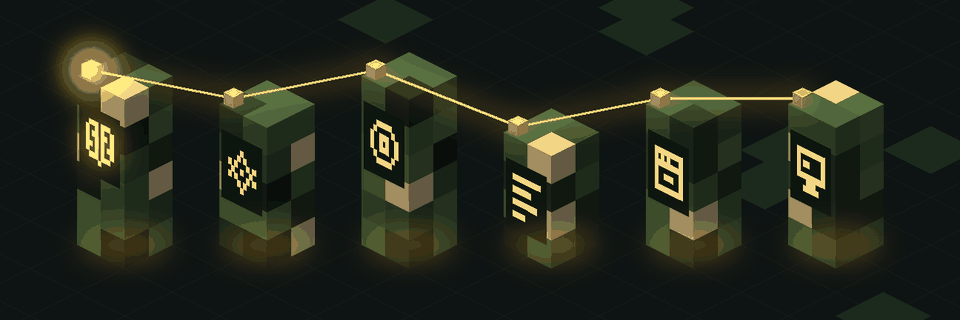

<picture>
  <source media="(prefers-reduced-motion: reduce)" srcset="assets/h-stack-banner.png">
  
</picture>

<p align="center">
  
</p>

<p align="center">
  
  <a href="https://github.com/EnzoVezzaro/hstack/releases"></a>
  
  <a href="LICENSE"></a>
</p>

# hstack

i've been running multi-agent coding setups for a while, trying to build more, spend less, and not become a full-time babysitter for AI agents. five versions later, this is the playbook.

**hstack** (read "high stack") is 52 agent skills for one idea: **expensive intelligence makes decisions, cheap intelligence does the work.** one assistant talks to you. it hands work down to directors, who hand bounded tasks to free-model workers. the workers prove what they did and report back. you only show up for the calls that matter.

they're plain [Agent Skills](https://agentskills.io): a folder of `skills/<name>/SKILL.md` files. they work in Claude Code, Codex, OpenCode, Cursor, and any agent that reads them.

## install

```bash
npx skills add EnzoVezzaro/hstack
```

the [`skills` CLI](https://skills.sh) lists every skill. pick the ones you want, then pick your agents. add `-g` to install for every project instead of just this one.

<details>
<summary>no npx? copy them by hand</summary>

```bash
git clone https://github.com/EnzoVezzaro/hstack.git
cp -R hstack/skills/* ~/.claude/skills/   # Claude Code
cp -R hstack/skills/* ~/.codex/skills/    # Codex
```

restart the agent so it finds them.

</details>

## get started

two steps:

1. install.
2. type [`/hstack`](skills/hstack/SKILL.md), then your task.

```
/hstack the signup button does nothing on mobile. repro it, fix it, and show me it works.
```

that's it. `/hstack` reads the request, picks the right skill, and splits mixed work into steps. reach for a specific skill when you already know which one you want.

<p align="center">
  <picture>
    <source media="(prefers-reduced-motion: reduce)" srcset="assets/animations/build-h.png">
    
  </picture>
</p>

<details>
<summary>how do skills actually trigger?</summary>

your agent doesn't read all 52 skills up front. at startup it only sees each skill's name and one-line description. the full instructions load when a skill is used, in one of two ways:

- **you call it.** type `/hstack`, `/humanize`, `/fix-ci`, and so on.
- **the agent matches it.** describe the task ("CI is failing on main") and the agent loads the skill whose description fits.

so installing all of them costs you almost nothing until one is needed.

</details>

<p align="center"></p>

## the stack (V5)

one voice in, a whole crew out. watch the gold pulse go down the layers:

<p align="center">
  <picture>
    <source media="(prefers-reduced-motion: reduce)" srcset="assets/animations/flow-v5.png">
    
  </picture>
</p>

| layer | who | does | costs |
|---|---|---|---|
| 🧠 assistant | Codex / ChatGPT | talks with you, plans, keeps track of everything | $20/mo |
| 🐋 orchestrator | ORCA | routes sessions, context, and work | free, open source |
| 🎯 directors | Claude Code / Codex | decide, design, accept the work | $20/mo |
| ⚙️ workers | OpenCode / Freebuff / Claude Code / Codex | code, debug, test, research on free models | free |
| 🌐 browser | Ego Lite | clicks through real websites | free, open source |
| 🖥️ desktop | computer use (Orca, Codex, Claude desktop) | drives native apps | included |

**$40/month for the whole crew.** subscription and free-tier limits apply; API costs and hosting aren't included. the full write-up, including how it got here from V1, is in [docs/hstack-v5.md](docs/hstack-v5.md).

the rules the crew runs on:

- expensive intelligence makes decisions. cheap intelligence handles execution.
- agents delegate, verify, and report back. a claim without evidence goes back for checking.
- humans stay in control. nothing gets pushed, merged, deployed, published, or deleted without a yes.
- more agents is not more intelligence. shared context and verified results are.

### cheap first, smart when it matters

every skill starts on the cheapest model that can do the job, and says so in its `SKILL.md`:

| tier | who | gets |
|---|---|---|
| **T0** free worker | OpenCode free models, NVIDIA free tier, Freebuff | tests, docs, cleanup, setup, first drafts |
| **T1** strong free worker | bigger free models (GLM, Nemotron Ultra, DeepSeek Pro) | debugging, multi-file changes, checking T0's work |
| **T2** director | Codex, Claude Code | plans, reviews, decisions |
| **T3** top reasoning | Codex high effort, Claude Opus | architecture, security, anything irreversible |

a task moves **up** one tier when the same brief fails verification twice, or when it touches architecture, security, money, or deleting data. it moves back **down** once the higher tier has written the plan: thinking is expensive, typing is cheap. whoever checks the work is never the one who wrote it.

run [`/setup-hstack`](skills/setup-hstack/SKILL.md) once. it finds the agents and models on your machine and writes your own tier map to `AGENTS.md`. the rules: [docs/model-routing.md](docs/model-routing.md).

<p align="center"></p>

## skills

`/hstack` routes to all of these for you. the tables are for when you want one directly.

<p align="center">
  <picture>
    <source media="(prefers-reduced-motion: reduce)" srcset="assets/animations/coordinate-bots.png">
    
  </picture>
</p>

<details open>
<summary><b>🌅 daily rhythm</b></summary>

| skill | use it when |
|---|---|
| [`/a-new-day`](skills/a-new-day/SKILL.md) | you're starting the day and want live Orca state, recent work, and the first move. |
| [`/plan-horizon`](skills/plan-horizon/SKILL.md) | you want a plan that fits a day, week, or month (`/plan-day`, `/plan-week`, `/plan-month`). |
| [`/wrap-day`](skills/wrap-day/SKILL.md) | you're done for the day and want verified progress, blockers, and tomorrow's first step. |
| [`/blocker-radar`](skills/blocker-radar/SKILL.md) | something is stuck and you want who owns it and the smallest next move (`/any-blockers`). |

</details>

<details open>
<summary><b>🎛️ running the crew</b></summary>

| skill | use it when |
|---|---|
| [`/relay-room`](skills/relay-room/SKILL.md) | the work belongs to a live Orca project and a director needs a bounded brief. |
| [`/coordinate-agents`](skills/coordinate-agents/SKILL.md) | several agents need tasks, and their reports need checking against evidence, not vibes. |
| [`/resume-work`](skills/resume-work/SKILL.md) | you said "continue". it checks what was really done before picking up the next step. |
| [`/handoff`](skills/handoff/SKILL.md) | another agent should take over. writes a brief they can pick up cold. |
| [`/setup-hstack`](skills/setup-hstack/SKILL.md) | first install, or you want to change which models each tier uses. |

</details>

<details open>
<summary><b>🌀 long horizon</b></summary>

| skill | use it when |
|---|---|
| [`/break-it-down`](skills/break-it-down/SKILL.md) | a task is too big for one agent. splits it into small checkable units with order, tiers, and what can run in parallel. |
| [`/horizon`](skills/horizon/SKILL.md) | work has to keep going for days or weeks. sets up a schedule (a Codex automation by default) with an end date and a progress log. |
| [`/horizon-loop`](skills/horizon-loop/SKILL.md) | you want something repeated until a number is hit. measure, change one thing, keep it only if it helped. |
| [`/horizon-loop-test`](skills/horizon-loop-test/SKILL.md) | the test suite needs to get to green, or to a coverage number, or to zero flakes. one failure at a time, never weakening a test. |
| [`/horizon-loop-ego-lite`](skills/horizon-loop-ego-lite/SKILL.md) | real browser flows need to pass N times in a row in Ego Lite. |

</details>

<details>
<summary><b>🛠️ build and fix</b></summary>

| skill | use it when |
|---|---|
| [`/implement-feature`](skills/implement-feature/SKILL.md) | you want a feature built. acceptance check first, then the smallest change. |
| [`/verify-and-fix`](skills/verify-and-fix/SKILL.md) | something is broken, or a change needs proving. repro, fix the cause, rerun the same path. |
| [`/save-point`](skills/save-point/SKILL.md) | it worked last week. compares with the last good version and repairs the cause. |
| [`/patch-patrol`](skills/patch-patrol/SKILL.md) | a diff needs a second pair of eyes that didn't write it. |
| [`/check-github`](skills/check-github/SKILL.md) | you want repos, code, or issues found on GitHub and compared. |
| [`/research-explain`](skills/research-explain/SKILL.md) | you have a question about a library, a repo, a market, or why code works this way. |
| [`/fix-ci`](skills/fix-ci/SKILL.md) | CI is red. reads the failing step, fixes the cause, never just disables the check. |
| [`/setup-install`](skills/setup-install/SKILL.md) | a project needs installing or configuring, without secrets leaking into files or chat. |
| [`/cleanup-refactor`](skills/cleanup-refactor/SKILL.md) | dead code needs to go, in small steps with tests after each one. |

</details>

<details>
<summary><b>👀 eyes on real screens</b></summary>

| skill | use it when |
|---|---|
| [`/run-local`](skills/run-local/SKILL.md) | you want the app running on localhost and the URL back. |
| [`/visual-test-ego-lite`](skills/visual-test-ego-lite/SKILL.md) | a website needs clicking through like a person would, in Ego Lite. |
| [`/visual-test-computer-use`](skills/visual-test-computer-use/SKILL.md) | a native desktop app needs the same: Mac apps, Electron, Tauri, the ChatGPT or Claude app. |
| [`/interface-check`](skills/interface-check/SKILL.md) | a screen needs an evidence-based UI pass at desktop and phone widths. |

</details>

<details>
<summary><b>🚀 ship it</b></summary>

| skill | use it when |
|---|---|
| [`/release`](skills/release/SKILL.md) | it's release time. next version, changelog from the real changes, tag, GitHub release. |
| [`/publish-git`](skills/publish-git/SKILL.md) | commit, push, merge. asks before anything leaves your machine. |
| [`/deploy`](skills/deploy/SKILL.md) | `/deploy <deployment-source>`. confirms target and version, deploys, checks the live version. |
| [`/cleanup-worktrees-branches`](skills/cleanup-worktrees-branches/SKILL.md) | you want everything merged to main and the leftover worktrees and branches gone. |
| [`/cleanup-disk-space`](skills/cleanup-disk-space/SKILL.md) | your disk is full. measures first, deletes only what you approve. |
| [`/product-hunt-launch`](skills/product-hunt-launch/SKILL.md) | you're launching. drafts the listing and assets, posts only when you say so. |

</details>

<details>
<summary><b>✍️ words, design, and quality</b></summary>

| skill | use it when |
|---|---|
| [`/ui-design`](skills/ui-design/SKILL.md) | you want a UI, landing page, or logo designed or fixed. |
| [`/antislop-review`](skills/antislop-review/SKILL.md) | something looks or reads like generic AI output. |
| [`/motion-graphic`](skills/motion-graphic/SKILL.md) | you want an animated explainer or short video, built with HyperFrames. |
| [`/humanize`](skills/humanize/SKILL.md) | text sounds like a chatbot wrote it. rewrites it, keeps every fact. |
| [`/docs-content`](skills/docs-content/SKILL.md) | docs, product data, or links are out of date. |
| [`/write-readme-opensource`](skills/write-readme-opensource/SKILL.md) | a project is going public and needs a README and CONTRIBUTING written from the real code. |
| [`/seo-audit`](skills/seo-audit/SKILL.md) | you want to know why search can't find you, ranked by impact. |
| [`/security-backend`](skills/security-backend/SKILL.md) | auth, endpoints, migrations, infra, or a leaked key need a serious look. |
| [`/skill-workbench`](skills/skill-workbench/SKILL.md) | you keep asking for the same thing. turns it into a new skill. |

</details>

<details open>
<summary><b>💡 ideas, review, and wind-down</b></summary>

| skill | use it when |
|---|---|
| [`/get-stoned`](skills/get-stoned/SKILL.md) | you need new ideas or a strange solution to something stuck. generates wide, flips assumptions, scores the ideas, picks two or three to prototype. |
| [`/haf`](skills/haf/SKILL.md) | you want unusual UI inspiration. hunts Awwwards, Codrops, Dribbble, Pinterest, and CodePen, and comes back with annotated references and design directions. |
| [`/puff-puff-pass`](skills/puff-puff-pass/SKILL.md) | you want it built on a cheap model and reviewed by a stronger, different one before it ships. |
| [`/pineapple-express`](skills/pineapple-express/SKILL.md) | you're done for the day. closes what can be closed, parks the rest with handoffs, stops leftover processes. |

</details>

<details open>
<summary><b>🧩 my own tools, wired in</b></summary>

| skill | use it when |
|---|---|
| [`/acc-context`](skills/acc-context/SKILL.md) | the repo uses [ACC](https://github.com/EnzoVezzaro/agents-code-context), or should. agents get focused context and shared memory instead of rediscovering the codebase. |
| [`/protect-repo`](skills/protect-repo/SKILL.md) | a repo is going public. [Repo Shield](https://github.com/EnzoVezzaro/repo-shield) opens a PR with a license, an AI-training notice, and a weekly watch. |
| [`/reposell-release`](skills/reposell-release/SKILL.md) | you want to sell a repo. [reposell](https://github.com/EnzoVezzaro/reposell) runs the audit and gates, then publishes when you say yes. |
| [`/proagent-equip`](skills/proagent-equip/SKILL.md) | a cheap worker needs to act like a specialist. [ProAgents](https://github.com/EnzoVezzaro/proagents) gives it a professional profile. |
| [`/ace-workspace`](skills/ace-workspace/SKILL.md) | you're spinning up a crew across several projects. [ACE](https://github.com/EnzoVezzaro/ace-proagents) sets up the governor, supervisors, workers, and budget. |

</details>

### examples

```
bug:          /hstack the scroll jumps every few seconds on the feed. repro first, then fix and verify.
crew:         /coordinate-agents check what the opencode workers did overnight and give them the next tasks.
continue:     /resume-work
handoff:      /handoff give this branch to a freebuff worker, they finish the tests.
web test:     /visual-test-ego-lite walk the checkout on mobile and tell me where a person gets stuck.
desktop test: /visual-test-computer-use kill the old builds, install the new one, and test the settings window.
ci:           /fix-ci
ship:         /cleanup-worktrees-branches merge all worktrees to main and close the stale PRs.
deploy:       /deploy main
launch:       /product-hunt-launch draft everything for tuesday. don't post.
words:        /humanize the launch post.
open source:  /write-readme-opensource
big task:     /break-it-down migrate the store to the new API.
long run:     /horizon review the reposell backlog every morning until december 15. stay quiet if nothing changed.
loop:         /horizon-loop get the landing page lighthouse score above 95.
tests:        /horizon-loop-test get every test green and keep it green 5 runs in a row.
browser loop: /horizon-loop-ego-lite run signup and checkout until each passes 10 times in a row.
release:      /release
ideas:        /get-stoned how could onboarding work without a signup form?
inspiration: /haf scroll-driven landing pages with 3D type, for a dev tool.
build+review: /puff-puff-pass add rate limiting to the public API.
wind down:    /pineapple-express
github:       /check-github best open source voice-to-text libraries for electron.
daily:        /a-new-day
models:       /setup-hstack
sell:         /reposell-release v1.2.0 at $29. audit first, don't publish yet.
specialist:   /proagent-equip security-engineer, then review the auth changes.
```

<p align="center"></p>

## some skills call others

install these together:

| skill | also install |
|---|---|
| `implement-feature` | `verify-and-fix` |
| `verify-and-fix` | `patch-patrol`, `save-point` |
| `coordinate-agents` | `relay-room`, `verify-and-fix`, `publish-git` |
| `publish-git`, `deploy`, `fix-ci`, `cleanup-refactor`, `security-backend` | `verify-and-fix` |
| `cleanup-worktrees-branches` | `publish-git` |
| `visual-test-ego-lite`, `visual-test-computer-use` | `run-local`, `verify-and-fix` |
| `ui-design` | `interface-check` |
| `horizon` | `break-it-down` |
| `horizon-loop-test`, `horizon-loop-ego-lite` | `horizon-loop`, `verify-and-fix` |
| `horizon-loop-ego-lite` | `run-local` |
| `release` | `verify-and-fix`, `humanize` |
| `product-hunt-launch` | `humanize`, `motion-graphic`, `ui-design` |
| `write-readme-opensource` | `security-backend`, `protect-repo` |
| `implement-feature`, `resume-work`, `handoff` | `acc-context` (when the repo has `.acc/`) |
| `reposell-release` | `protect-repo` |
| `coordinate-agents` | `proagent-equip`, `ace-workspace` |
| `puff-puff-pass` | `implement-feature`, `patch-patrol`, `publish-git` |
| `haf` | `ui-design`, `motion-graphic` |
| `get-stoned` | `break-it-down` |
| `pineapple-express` | `handoff`, `wrap-day`, `publish-git` |
| `hstack` | everything it routes to |

## not shipped here

a few skills lean on skills that live elsewhere. a missing one is reported, not faked:

- `ego-browser` (Ego Lite), `orca-cli`, `orchestration`, and `orca-computer-use` for the crew and the screens.
- the `antislop` family and `impeccable` for design and writing checks.
- the `hyperframes` family and `media-use` for `motion-graphic`.
- `humanizer` for `humanize`. without it, `humanize` falls back to the `antislop-copywriting` rules.
- `skill-creator` for `skill-workbench`.
- the `acc`, `rs`, `reposell`, `proagent`, and `ace-proagents` CLIs for my own tools. each skill installs its CLI from npm when it's missing.

where each one was found, and what it adds: [docs/source-skills.md](docs/source-skills.md).

<p align="center"></p>

## make it yours

this is my setup. yours won't be.

- put your crew in `CLAUDE.md` or `AGENTS.md`: which agents you run, which free models, which deploy targets. the skills read it, and you can update them without losing it.
- running one agent, no Orca? most skills still work. the crew and daily ones need Orca; the rest just need a repo.
- keep asking for the same thing? type `/skill-workbench` and turn it into a skill.
- want the animations for your own README? `python3 scripts/generate_hstack_animations.py` regenerates them.

<p align="center">
  <picture>
    <source media="(prefers-reduced-motion: reduce)" srcset="assets/animations/ship-launch.png">
    
  </picture>
</p>

## docs

- [docs/hstack-v5.md](docs/hstack-v5.md): roles, economics, and which layer runs each skill.
- [docs/workflows.md](docs/workflows.md): the workflows these skills came from.
- [docs/role-model.md](docs/role-model.md): the short version of the roles.
- [docs/workflow-map.md](docs/workflow-map.md) and [docs/skill-usage.md](docs/skill-usage.md): the evidence behind them.

## credits

structure borrowed with love from [tstack](https://github.com/t3dotgg/tstack) (the "use it when" tables and the dependency note) and [pstack](https://github.com/backnotprop/pstack) (one front door that routes to everything).

## license

[MIT](LICENSE)

<p align="center">
  <br>
  <sub>built with AI, coffee, and a little weed.</sub>
</p>
