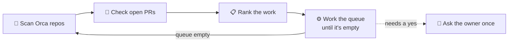
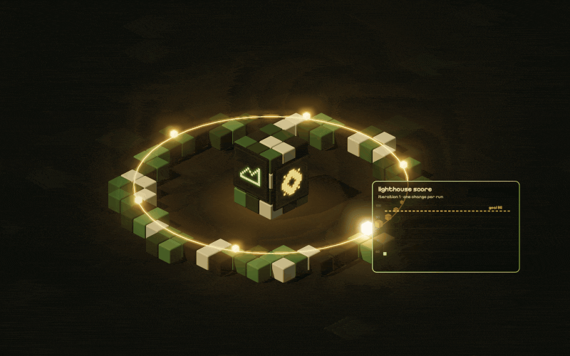

<picture>
  <source media="(prefers-reduced-motion: reduce)" srcset="assets/h-stack-banner.png">
  
</picture>

<p align="center">
  
</p>

<p align="center">
  
  <a href="https://github.com/EnzoVezzaro/hstack/releases"></a>
  
  <a href="LICENSE"></a>
</p>

# HSTACK

I run a small crew of AI agents for $40 a month. One of them listens to me, two of them make the decisions, and a handful of free ones do the typing. It took five versions to get here. Somewhere around the third one, I stopped babysitting terminals and started finishing my coffee while it was still warm.

HSTACK (read "high stack") is that setup, written down as 60 agent skills for coordinating work across multiple repositories. It runs on one rule: expensive models make decisions and cheap models do the work. The paid models plan and review; the free ones write the code. Nothing gets merged, deployed, or deleted until I say yes.

The skills are plain [Agent Skills](https://agentskills.io), a folder of `skills/<name>/SKILL.md` files, so they work in Claude Code, Codex, OpenCode, Cursor, and most agents that read the format.

## Install

```bash
npx skills add EnzoVezzaro/hstack
```

The [`skills` CLI](https://skills.sh) shows you the full list. Pick the skills you want, pick your agents, and you're done. Add `-g` to install them for every project instead of just this one.

<details>
<summary>Rather copy the files by hand?</summary>

```bash
git clone https://github.com/EnzoVezzaro/hstack.git
cp -R hstack/skills/* ~/.claude/skills/   # Claude Code
cp -R hstack/skills/* ~/.codex/skills/    # Codex
```

Restart your agent so it notices the new skills.

</details>

<p align="center">
  <picture>
    <source media="(prefers-reduced-motion: reduce)" srcset="assets/animations/install-terminal.png">
    
  </picture>
</p>

## What's new in v5.2.0

- The model pyramid now starts with you and ChatGPT on top, then gods mode (Fable, Astra), directors (Opus, GPT Sol), supervisors (Sonnet, Terra, OpenCode Go), and workers (Haiku, Luna, OpenCode Go or free models).
- A zero-dollar pyramid for OpenCode and Freebuff only, with its limits written out.
- The routing doc, the map, and the elevator use the same tier names.

Full notes, with the Freebuff suspension and the skill list: [release v5.2.0](https://github.com/EnzoVezzaro/hstack/releases/tag/v5.2.0).

## Getting started

H Stack is for **multi-repo work**. Name the target project in every request; for work across repos, name each project. `<project>` is a placeholder for the actual Orca project/repo name:

```
/hstack <project> The signup button does nothing on mobile. Reproduce it, fix it, and show me it works.
```

[`/hstack`](skills/hstack/SKILL.md) resolves the named repo/worktree, picks the skill that fits, splits big jobs into steps, and keeps the expensive models away from the boring parts. A cross-repo request names each `<project>` separately. When you already know which skill you want, call it by name and include the project. Run [`/setup-hstack`](skills/setup-hstack/SKILL.md) once per project, so it knows which agents and models you actually have.

<details>
<summary>How do skills get picked up?</summary>

Your agent doesn't read 60 instruction files every time it starts. It reads one line per skill, a bit like skimming a menu, and loads the full instructions only when a skill is needed. That happens in one of two ways:

- You call it by name, like `/fix-ci`.
- The agent recognizes the job. Say "CI is red again" and it loads the skill whose description matches.

So installing all 60 costs almost nothing until you use one.

</details>

<p align="center"></p>

## The stack

<p align="center">
  <picture>
    <source media="(prefers-reduced-motion: reduce)" srcset="assets/animations/stack-office.png">
    
  </picture>
</p>

One voice goes in at the top, and a whole crew answers across your repositories. Orca keeps project context and worktrees distinct; each task must name its target repo:

| Layer | Who | What it does | Cost |
|---|---|---|---|
| 🧠 Assistant | Codex / ChatGPT | Talks with me, plans the day, remembers what I forgot | $20/mo |
| 🐋 Orchestrator | ORCA | Routes sessions, context, and work between agents | Free, open source |
| 🎯 Directors | Claude Code / Codex | Decide, design, and accept or reject the work | $20/mo |
| ⚙️ Workers | OpenCode, ~~Freebuff~~ ([benched](#a-note-to-the-freebuff-team)), Claude Code, Codex | Write code, debug, test, and research on cheap or free models | Included or free |
| 🌐 Browser | Ego Lite | Clicks through real websites | Free, open source |
| 🖥️ Desktop | Computer use (Orca, Codex, Claude desktop) | Drives native apps | Included |

That's $40 a month for the whole crew. Subscription and free-tier limits apply. API costs, hosting, and the model you forgot to switch off are not included. The long version, including how V1 turned into V5, lives in [docs/hstack-v5.md](docs/hstack-v5.md).

The house rules:

- Expensive intelligence makes decisions; cheap intelligence does the execution.
- Agents delegate, verify, and report back. "Trust me, it works" gets sent back for proof.
- Humans stay in control. Pushes, merges, deploys, launches, and deletes wait for a yes.
- More agents is not more intelligence. A big crew that shares nothing is just a loud one.

### A note to the Freebuff team

@jahooma, @brandonkachen, @victorxheng, and everyone at @CodebuffAI: thank you, genuinely. Freebuff carried a big share of the free T0 work in this stack, and it was good at it. Ads and all, I was a fan.

Then, right in the middle of the best agent run of my week, with the whole crew humming and the coffee still warm, you pulled the plug:

```text
This account is suspended. To appeal, visit https://freebuff.com/account?tab=standing.
If this is a mistake, contact support@freebuff.com.
```

Great timing. I honestly don't know what my robots did; they're mostly polite. If it's a mistake, I'd love my workers back, because the bench is cold. Until then, Freebuff's share of the work goes to OpenCode's free models and NVIDIA's free tier, and the whole crew still costs $40 a month.

## The whole map

<details open>
<summary><b>Every layer, every model, and all 60 skills, top to bottom</b></summary>

<p align="center">
  <picture>
    <source media="(prefers-reduced-motion: reduce)" srcset="assets/animations/architecture.png">
    
  </picture>
</p>

<sub>Logos belong to their owners and are only here to show which tool does what.</sub>

</details>

## Cheap first, smart when it matters

<p align="center">
  <picture>
    <source media="(prefers-reduced-motion: reduce)" srcset="assets/animations/tier-pyramid.png">
    
  </picture>
</p>

Every skill starts on the cheapest model that can do the job, and says which tier in its `SKILL.md`:

| Tier | Name | Anthropic | OpenAI | Also works |
|---|---|---|---|---|
| You | Owner | | | Approve, decide, own the product |
| ChatGPT | Main coordinator and assistant | | | Talks to you, plans the day, routes work down |
| T3 | Gods mode | Fable | Astra | |
| T2 | Directors | Opus | GPT Sol | |
| T1 | Supervisors | Sonnet | Terra | OpenCode Go (optional) |
| T0 | Workers | Haiku | Luna | OpenCode Go, or free models |

The shape matters more than the brands. GLM (Z.ai), DeepSeek, Kimi, or any other provider fits the same pyramid: their biggest model at the top, their fast one at the bottom.

A job moves up one tier when the same brief fails twice, or when it touches architecture, security, money, or deleting things. Once the smarter model has written the plan, the job goes back down, because thinking is expensive and typing is cheap. Whoever checks the work is never the one who wrote it, since everybody grades their own homework an A.

<p align="center">
  <picture>
    <source media="(prefers-reduced-motion: reduce)" srcset="assets/animations/tier-elevator.png">
    
  </picture>
</p>

That's the rule in motion: a task fails twice with the workers, rides up, fails again, gets a plan from the directors, and comes back down to be finished by a worker. Gods mode naps through all of it, which is exactly the point. The full rules are in [docs/model-routing.md](docs/model-routing.md).

<details>
<summary><b>The zero-dollar version: OpenCode and Freebuff only</b></summary>

<p align="center">
  <picture>
    <source media="(prefers-reduced-motion: reduce)" srcset="assets/animations/tier-pyramid-free.png">
    
  </picture>
</p>

It works, with fine print:

- Free models come and go, and rate limits tend to hit in the middle of a task.
- Freebuff runs on ads, and full mode is only available in some countries.
- Limited mode gets DeepSeek V4 Flash and MiMo 2.5, and six one-hour sessions a day.
- Some free models are labeled "Collects data for training". Read the label before you paste code.
- Accounts can be suspended without warning. [Ask me how I know](#a-note-to-the-freebuff-team).

</details>

<p align="center"></p>

## Stoner mode

Some days you want to point the crew at your repos and go do something else. [`/stoner`](skills/stoner/SKILL.md) is for those days. It scans every Orca repo, checks the open PRs on each one, ranks the work, and keeps agents on it until the queue is empty. Then it checks the PRs again, because by then someone has opened a new one.



It pushes fixes to each PR's own branch without asking, because that's the job you gave it. It doesn't merge into main, close PRs, delete branches, or deploy unless you say yes or leave a standing rule in `AGENTS.md`:

```markdown
## stoner
- max workers: 3
- auto-merge: green-and-approved
- idle wait: 30
- stop after: 8 hours
```

Under the hood it's `coordinate-agents`, `fix-ci`, `puff-puff-pass`, and `reconcile-branches` taking turns, with every task escalating by the tier rules above. It stops when you tell it to, when the budget runs out, or when there's genuinely nothing left to do. Then it waits quietly and checks again.

<p align="center"></p>

## Skills

`/hstack` routes to every one of these. Name the `<project>` whenever the task concerns a repository; for multi-repo work, list each project. The tables are for when you already know what you want.

<p align="center">
  <picture>
    <source media="(prefers-reduced-motion: reduce)" srcset="assets/animations/ship-pipeline.png">
    
  </picture>
</p>

<details open>
<summary><b>🌅 Daily rhythm</b></summary>

| Skill | Use it when |
|---|---|
| [`/a-new-day`](skills/a-new-day/SKILL.md) | It's morning. Pulls live Orca state and recent work, and hands you the first move of the day. |
| [`/plan-horizon`](skills/plan-horizon/SKILL.md) | You want a plan that actually fits in a day, a week, or a month (`/plan-day`, `/plan-week`, `/plan-month`). |
| [`/wrap-day`](skills/wrap-day/SKILL.md) | You're logging off and want to know what really got done, what's stuck, and where tomorrow starts. |
| [`/blocker-radar`](skills/blocker-radar/SKILL.md) | Something is stuck and you'd like a name and a next step rather than a vibe (`/any-blockers`). |

</details>

<details open>
<summary><b>🎛️ Running the crew</b></summary>

| Skill | Use it when |
|---|---|
| [`/relay-room`](skills/relay-room/SKILL.md) | The work belongs to a live Orca project and a director needs a short, clear brief. |
| [`/coordinate-agents`](skills/coordinate-agents/SKILL.md) | Several agents need work, and every "all done!" they send back needs checking. |
| [`/resume-work`](skills/resume-work/SKILL.md) | You typed "continue". It checks what actually got done before it believes anyone. |
| [`/handoff`](skills/handoff/SKILL.md) | Another agent should take over. Writes a brief they can pick up cold, with no backstory required. |
| [`/setup-hstack`](skills/setup-hstack/SKILL.md) | It's your first install. Finds your agents and models and writes your tier map to `AGENTS.md`. |
| [`/token-balancer`](skills/token-balancer/SKILL.md) | Checks available Orca subscription limits across named projects and recommends a model for the next task, with evidence. |

</details>

<p align="center">
  <picture>
    <source media="(prefers-reduced-motion: reduce)" srcset="assets/animations/horizon-loop.png">
    
  </picture>
</p>

<details open>
<summary><b>🌀 Long-horizon work</b></summary>

| Skill | Use it when |
|---|---|
| [`/stoner`](skills/stoner/SKILL.md) | You want to walk away. Checks every Orca repo's PRs, works the queue until it's empty, then starts over. See [Stoner mode](#stoner-mode). |
| [`/break-it-down`](skills/break-it-down/SKILL.md) | The task is too big for one session. Splits it into small pieces that can each be checked, with an order and a tier for each. |
| [`/horizon`](skills/horizon/SKILL.md) | The job takes weeks. Sets up a schedule (a Codex automation by default) with an end date and a progress log. |
| [`/horizon-loop`](skills/horizon-loop/SKILL.md) | You want something repeated until a number is hit. Measure, change one thing, and keep it only if it helped. |
| [`/horizon-loop-test`](skills/horizon-loop-test/SKILL.md) | The test suite needs to get green and stay green. One failure at a time, and no test gets quietly "adjusted". |
| [`/horizon-loop-ego-lite`](skills/horizon-loop-ego-lite/SKILL.md) | Real browser flows have to pass N times in a row in Ego Lite before anyone calls it fixed. |

</details>

<details>
<summary><b>🛠️ Build and fix</b></summary>

| Skill | Use it when |
|---|---|
| [`/implement-feature`](skills/implement-feature/SKILL.md) | You want a feature. Writes the acceptance check first, then the smallest change that passes it. |
| [`/verify-and-fix`](skills/verify-and-fix/SKILL.md) | Something broke, or a change needs proving. Reproduces it, fixes the cause, and reruns the exact same path. |
| [`/save-point`](skills/save-point/SKILL.md) | It worked last week. Compares with the last good version and repairs whatever changed. |
| [`/patch-patrol`](skills/patch-patrol/SKILL.md) | A diff needs a second pair of eyes that didn't write it. |
| [`/check-github`](skills/check-github/SKILL.md) | You want repos, code, or issues found on GitHub and compared, with links. |
| [`/research-explain`](skills/research-explain/SKILL.md) | You have a question about a library, a market, or why this code is the way it is. |
| [`/fix-ci`](skills/fix-ci/SKILL.md) | CI is red. Reads the failing step and fixes the cause. Disabling the check doesn't count. |
| [`/setup-install`](skills/setup-install/SKILL.md) | A project needs installing or configuring, and your secrets should stay out of files and chat. |
| [`/cleanup-refactor`](skills/cleanup-refactor/SKILL.md) | Dead code has to go, in small steps, with the tests run after each one. |

</details>

<details>
<summary><b>👀 Eyes on real screens</b></summary>

| Skill | Use it when |
|---|---|
| [`/run-local`](skills/run-local/SKILL.md) | You want it running on localhost and the URL back, minus the "works on my machine" speech. |
| [`/visual-test-ego-lite`](skills/visual-test-ego-lite/SKILL.md) | A website needs clicking through the way a person would, in Ego Lite. |
| [`/visual-test-computer-use`](skills/visual-test-computer-use/SKILL.md) | Same idea for native apps: Mac apps, Electron or Tauri builds, the ChatGPT or Claude desktop app. |
| [`/interface-check`](skills/interface-check/SKILL.md) | A screen needs a UI pass at desktop and phone widths, with screenshots instead of opinions. |

</details>

<details>
<summary><b>🚀 Ship it</b></summary>

| Skill | Use it when |
|---|---|
| [`/reconcile-branches`](skills/reconcile-branches/SKILL.md) | Several branches and worktrees want into main. Tests every merge first, plans the order, rehearses it, and lands it after your yes. |
| [`/release`](skills/release/SKILL.md) | It's release time. Picks the next version, writes the changelog from what actually changed, tags it, and publishes the GitHub release. |
| [`/publish-git`](skills/publish-git/SKILL.md) | Commit, push, merge. Asks before anything leaves your machine. |
| [`/deploy`](skills/deploy/SKILL.md) | `/deploy <deployment-source>`. Confirms the target and version, deploys, then checks the live site runs that version. |
| [`/set-analytics`](skills/set-analytics/SKILL.md) | You'd like to know if anyone uses the thing. Installs PostHog (by default), plans the first events, adds a proxy and consent, and checks real events arrive. |
| [`/product-hunt-launch`](skills/product-hunt-launch/SKILL.md) | It's launch day. Drafts the listing and the assets, and posts only when you say go. |

</details>

<details open>
<summary><b>🧹 Housekeeping</b></summary>

| Skill | Use it when |
|---|---|
| [`/cleanup-orca`](skills/cleanup-orca/SKILL.md) | Your Orca sidebar looks like a browser with 80 tabs. Merges what it can, closes what's done, and keeps anything with unmerged work. |
| [`/cleanup-chats`](skills/cleanup-chats/SKILL.md) | Codex and ChatGPT are full of finished threads. Carries the loose ends into one brief per project, then archives the rest. |
| [`/cleanup-worktrees-branches`](skills/cleanup-worktrees-branches/SKILL.md) | You want everything merged to main and the leftover worktrees and branches gone. |
| [`/cleanup-disk-space`](skills/cleanup-disk-space/SKILL.md) | Your disk is full. (Mine filled up while these animations were rendering.) Measures first and deletes only what you approve. |

</details>

<details>
<summary><b>✍️ Words, design, and quality</b></summary>

| Skill | Use it when |
|---|---|
| [`/ui-design`](skills/ui-design/SKILL.md) | You want a UI, a landing page, or a logo designed or fixed. |
| [`/antislop-review`](skills/antislop-review/SKILL.md) | It looks like every other AI-generated landing page, gradient included. |
| [`/motion-graphic`](skills/motion-graphic/SKILL.md) | You want an animated explainer or a short video, built with HyperFrames. |
| [`/humanize`](skills/humanize/SKILL.md) | The text reads like a chatbot on its third espresso. Rewrites it and keeps every fact. |
| [`/docs-content`](skills/docs-content/SKILL.md) | Docs, product data, or links have drifted away from reality. |
| [`/write-readme-opensource`](skills/write-readme-opensource/SKILL.md) | A project is going public and needs a README and CONTRIBUTING written from the real code. |
| [`/seo-audit`](skills/seo-audit/SKILL.md) | Search can't find you, and you'd like to know why, ranked by how much it hurts. |
| [`/security-backend`](skills/security-backend/SKILL.md) | Auth, endpoints, migrations, infra, or a key that ended up somewhere it shouldn't. Starts on a top-tier model. |
| [`/skill-workbench`](skills/skill-workbench/SKILL.md) | You keep asking for the same thing. Turns it into a skill so you can stop asking. |

</details>

<details open>
<summary><b>🎧 Coding, weed, and music</b></summary>

| Skill | Use it when |
|---|---|
| [`/420`](skills/420/SKILL.md) | It's time for a new sesh. Starts your music (Apple Music or YouTube), opens the ChatGPT app with [Oreja](https://github.com/EnzoVezzaro/oreja) so the music steps aside whenever ChatGPT talks, and lines up the first task. |
| [`/let-me-watch`](skills/let-me-watch/SKILL.md) | You want to see it running. Opens the local site, the desktop app, or an emulator with the project already up. |
| [`/get-stoned`](skills/get-stoned/SKILL.md) | You need new ideas or a strange way out of something stuck. Flips the assumptions, scores every idea, and picks a few worth prototyping. |
| [`/haf`](skills/haf/SKILL.md) | You want unusual UI inspiration. Hunts Awwwards, Codrops, Dribbble, Pinterest, and CodePen, and comes back with annotated references. |
| [`/puff-puff-pass`](skills/puff-puff-pass/SKILL.md) | You want it built on a cheap model and reviewed by a stronger, different one before it ships. |
| [`/pineapple-express`](skills/pineapple-express/SKILL.md) | You're done for the day. Closes what can be closed, parks the rest with handoffs, and stops the processes your agents left running. |

</details>

<details open>
<summary><b>🧩 My own tools, wired in</b></summary>

| Skill | Use it when |
|---|---|
| [`/acc-context`](skills/acc-context/SKILL.md) | The repo uses [ACC](https://github.com/EnzoVezzaro/agents-code-context), or should. Agents get focused context and shared memory instead of relearning your codebase every morning. |
| [`/protect-repo`](skills/protect-repo/SKILL.md) | A repo is going public. [Repo Shield](https://github.com/EnzoVezzaro/repo-shield) opens a PR with a license, an AI-training notice, and a weekly watch. |
| [`/reposell-release`](skills/reposell-release/SKILL.md) | You want to sell a repo. [reposell](https://github.com/EnzoVezzaro/reposell) runs the audit and the gates, and publishes when you say yes. |
| [`/proagent-equip`](skills/proagent-equip/SKILL.md) | A cheap worker needs to act like a specialist. [ProAgents](https://github.com/EnzoVezzaro/proagents) gives it a professional profile. |
| [`/ace-workspace`](skills/ace-workspace/SKILL.md) | You're setting up a crew across several projects. [ACE](https://github.com/EnzoVezzaro/ace-proagents) creates the governor, supervisors, workers, and budget. |

</details>

### Examples

```
bug:          /hstack <project> The feed jumps every few seconds. Reproduce it first, then fix and verify.
multi-repo:   /hstack <project-a>, <project-b> Update the shared API contract, then verify each consumer repo separately.
crew:         /coordinate-agents <project-a>, <project-b> Check each project's workers and give them the next tasks.
continue:     /resume-work
handoff:      /handoff <project> Give this branch to an OpenCode worker so they can finish the tests.
stoner:       /stoner Work through every open PR. Don't merge anything into main without me.
big task:     /break-it-down <project> Migrate the store to the new API.
long run:     /horizon <project> Review the backlog every morning until December 15. Stay quiet if nothing changed.
loop:         /horizon-loop <project> Get the landing page Lighthouse score above 95.
tests:        /horizon-loop-test <project> Get every test green and keep it green for five runs in a row.
browser:      /visual-test-ego-lite <project> Walk the checkout on mobile and tell me where a person gets stuck.
desktop:      /visual-test-computer-use <project> Kill the old builds, install the new one, and test the settings window.
merge:        /reconcile-branches Get every open worktree that's ready into main.
orca:         /cleanup-orca Merge what you can and close as much as possible.
chats:        /cleanup-chats Archive the finished Codex threads and keep the open items.
release:      /release <project>
deploy:       /deploy <project> main
analytics:    /set-analytics <project> PostHog, EU region, session replay only after cookie consent.
launch:       /product-hunt-launch <project> Draft everything for Tuesday. Don't post.
words:        /humanize <project> the launch post.
ideas:        /get-stoned <project> How could onboarding work without a signup form?
inspiration:  /haf <project> Scroll-driven landing pages with 3D type, for a developer tool.
review:       /puff-puff-pass <project> Add rate limiting to the public API.
new sesh:     /420
watch:        /let-me-watch <project> The mobile app, on the Android emulator.
wind down:    /pineapple-express
```

<p align="center"></p>

## Some skills call others

Install these together:

| Skill | Also install |
|---|---|
| `implement-feature` | `verify-and-fix` |
| `verify-and-fix` | `patch-patrol`, `save-point` |
| `coordinate-agents` | `relay-room`, `verify-and-fix`, `publish-git`, `proagent-equip`, `ace-workspace` |
| `publish-git`, `deploy`, `fix-ci`, `cleanup-refactor`, `security-backend` | `verify-and-fix` |
| `reconcile-branches` | `verify-and-fix`, `cleanup-worktrees-branches` |
| `cleanup-worktrees-branches` | `reconcile-branches` |
| `cleanup-orca` | `reconcile-branches`, `handoff` |
| `cleanup-chats` | `acc-context` (when a repo has `.acc/`) |
| `pineapple-express` | `handoff`, `wrap-day`, `cleanup-orca`, `cleanup-chats` |
| `visual-test-ego-lite`, `visual-test-computer-use` | `run-local`, `verify-and-fix` |
| `horizon` | `break-it-down` |
| `horizon-loop-test`, `horizon-loop-ego-lite` | `horizon-loop`, `verify-and-fix` |
| `release` | `verify-and-fix`, `humanize` |
| `puff-puff-pass` | `implement-feature`, `patch-patrol`, `publish-git` |
| `ui-design`, `haf` | `interface-check`, `ui-design` |
| `product-hunt-launch` | `humanize`, `motion-graphic`, `ui-design` |
| `write-readme-opensource`, `reposell-release` | `protect-repo` |
| `implement-feature`, `resume-work`, `handoff` | `acc-context` (when a repo has `.acc/`) |
| `stoner` | `coordinate-agents`, `fix-ci`, `verify-and-fix`, `puff-puff-pass`, `reconcile-branches`, `break-it-down`, `handoff`, `horizon` |
| `420` | `resume-work`, `let-me-watch` |
| `let-me-watch` | `run-local` |
| `set-analytics` | `run-local`, `publish-git` |
| `hstack` | Everything it routes to |

## Not shipped here

A few skills lean on skills that live elsewhere. When one is missing, the skill says so instead of faking it:

- `ego-browser` (Ego Lite), `orca-cli`, `orchestration`, and `orca-computer-use` for the crew and the screens.
- The `antislop` family and `impeccable` for design and writing checks.
- The `hyperframes` family and `media-use` for `motion-graphic`.
- `humanizer` for `humanize`, plus `copywriting` and `copy-editing` from [marketingskills](https://github.com/coreyhaines31/marketingskills) for launch copy.
- `skill-creator` for `skill-workbench`.
- The PostHog wizard (`npx @posthog/wizard@latest`), or the PostHog MCP when it's connected, for `set-analytics`.
- The `acc`, `rs`, `reposell`, `proagent`, and `ace-proagents` CLIs for my own tools. Each skill installs its CLI from npm when it's missing.

Where each one was found, and what it adds: [docs/source-skills.md](docs/source-skills.md).

<p align="center"></p>

## Make it yours

This is my setup. Yours will have different agents, different models, and probably a different snack drawer.

- Write your crew into `CLAUDE.md` or `AGENTS.md`: which agents, which free models, which deploy targets, what budget. The skills read it, so you can update HSTACK without losing your settings.
- Running one agent without Orca? Most skills still work. The crew and daily ones want Orca; the rest only need a repo.
- If you catch yourself asking for the same thing three times, `/skill-workbench` turns it into a skill.

### How the animations are made

Every animation on this page is rendered from code. Each scene is a small Three.js file in [`scripts/animations/src/scenes`](scripts/animations/src/scenes), drawn in headless Chrome with soft shadows and bloom, then encoded to GIF with ffmpeg and gifsicle. To render them yourself:

```bash
cd scripts/animations
npm install
npm run render            # every scene
npm run render -- tier-elevator --frames 48   # one scene, shorter
```

It needs Google Chrome (or `CHROME=/path/to/chrome`), ffmpeg, Python 3 with numpy and Pillow, and optionally gifsicle. The code on the monitors is real; it's the routing logic from this README. Brand marks in the map come from [Simple Icons](https://simpleicons.org) (CC0) or from each app's own icon, and they belong to their owners.

## Docs

- [docs/hstack-v5.md](docs/hstack-v5.md): roles, economics, my own tools, and which layer runs each skill.
- [docs/model-routing.md](docs/model-routing.md): the tiers and when a job moves up or down.
- [docs/workflows.md](docs/workflows.md): the workflows these skills came from.
- [docs/role-model.md](docs/role-model.md): the short version of the roles.
- [docs/workflow-map.md](docs/workflow-map.md) and [docs/skill-usage.md](docs/skill-usage.md): the evidence behind all of it.

## Credits

Huge thanks to [Theo](https://github.com/t3dotgg), for [tstack](https://github.com/t3dotgg/tstack), and to [Poteto](https://github.com/poteto), for [pstack](https://github.com/backnotprop/pstack), for everything they share with the rest of us, and for being great engineers who helped pioneer vibe coding, better known these days as agentic coding.

## License

[MIT](LICENSE)

<p align="center">
  <br>
  <sub>Built with AI, coffee, and a little weed.</sub>
</p>
