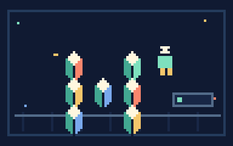

<div align="center">



# HSTACK

### A pocket-sized control room for the way you build with agents.

**Retro engineering rituals. Clear handoffs. Proof before done.**

[Workflows](#the-cartridges) · [Install](#install) · [Use](#pick-a-cartridge) · [Principles](#how-hstack-works)

</div>

---

HStack is a personal, open workflow kit for **Codex, Claude Code, and other agents that read `SKILL.md` files**. Its top-level router is **Enzo Coding Playbook**, a front-console skill that sends a task to one small, named playbook. The kit ships thirteen skills: one router plus twelve cartridges. Those cartridges reflect a month of observed work: project coordination, UI audits, code review, research, releases, portfolio briefs, and day planning.

The look borrows from hand-held consoles and chunky voxel games: ink-blue screens, warm paper, mint pixels, and one little cube-building mascot. The motion in the header is a looping pixel animation; it is decoration, not a status indicator.

## The cartridges

Start with **Enzo Coding Playbook** for engineering work, or invoke a cartridge directly when you know what you need.

| Cartridge | Say | Use it for |
| --- | --- | --- |
| [Enzo Coding Playbook](skills/enzo-coding-playbook/SKILL.md) | “Use my stack” | Route a non-trivial engineering task to the right playbook. |
| [Relay Room](skills/relay-room/SKILL.md) | `/relay-room` | Coordinate an existing Orca project, director, or bounded worker wave. |
| [Pixel Check](skills/pixel-check/SKILL.md) | `/pixel-check` | Inspect and repair a real interface with browser or app evidence. |
| [Patch Patrol](skills/patch-patrol/SKILL.md) | `/patch-patrol` | Independently review a diff and verify the requested behavior. |
| [Save Point](skills/save-point/SKILL.md) | `/save-point` | Find the last known-good version and repair a regression. |
| [Skill Workbench](skills/skill-workbench/SKILL.md) | `/skill-workbench` | Turn repeated, evidenced work into a portable skill. |
| [Field Notes](skills/field-notes/SKILL.md) | `/field-notes` | Research a question or draft using traceable sources and evidence. |
| [Launch Runway](skills/launch-runway/SKILL.md) | `/launch-runway` | Prepare and verify a release, deployment, publication, or launch. |
| [Portfolio Radio](skills/portfolio-radio/SKILL.md) | `/portfolio-radio` | Reconcile live multi-project activity into a useful status brief. |
| [A New Day](skills/a-new-day/SKILL.md) | `/a-new-day` | Start the day with yesterday’s evidence, live work, and today’s next steps. |
| [Plan Horizon](skills/plan-horizon/SKILL.md) | `/plan-day`, `/plan-week`, `/plan-month` | Turn current priorities into a feasible plan for a time horizon. |
| [Wrap Day](skills/wrap-day/SKILL.md) | `/wrap-day` | Close the day with verified progress and tomorrow’s next action. |
| [Blocker Radar](skills/blocker-radar/SKILL.md) | `/any-blockers` | Find current blockers, owners, evidence, and the smallest next step. |

### How the work is grouped

```text
Enzo Coding Playbook ── routes engineering tasks
  ├─ Relay Room · coordinate people and worktrees
  ├─ Pixel Check · inspect and repair the experience
  ├─ Patch Patrol · review and prove a change
  ├─ Save Point · recover a known-good behavior
  └─ Skill Workbench · capture a repeated method

Field Notes · gather evidence and write from sources
Launch Runway · prepare and verify a release
Portfolio Radio · brief the project portfolio

A New Day · Plan Horizon · Wrap Day · Blocker Radar
  └─ daily and longer-horizon operations
```

The names and workflow instructions are HStack’s own. The workflow map explains which patterns came from observed use and which are new compositions: [docs/workflow-map.md](docs/workflow-map.md). Counts and source limits are recorded in [docs/skill-usage.md](docs/skill-usage.md). For structural inspiration, see [T‑Stack](https://github.com/t3dotgg/tstack) and [P‑Stack](https://github.com/cursor/plugins/tree/main/pstack); HStack does not copy their skill text.

## Install

Clone the repository, then copy the skill folders into the directory your agent reads. For Codex or Claude Code:

```bash
git clone https://github.com/EnzoVezzaro/hstack.git
cp -R hstack/skills/* ~/.codex/skills/   # Codex
cp -R hstack/skills/* ~/.claude/skills/  # Claude Code
```

Restart the agent session if it does not discover newly added skills. Keep HStack’s `docs/` folder nearby: it contains the workflow map, provenance, and operating model.

## Pick a cartridge

Give the agent a direct task, or name a route:

```text
Use my stack: reproduce the scrolling regression, fix its cause, and verify the same path.
/pixel-check the onboarding flow at desktop and mobile widths; report findings before repairs.
/field-notes compare the current options using primary sources and link every claim.
/portfolio-radio give me a Friday portfolio report: verified progress, active work, blockers, next actions.
```

Slash names are clear invocation phrases in agent chat. A skill file does not register a slash command with every tool; the agent must support reading local `SKILL.md` files.

## How HStack works

- **Read the live state.** A saved report, old session, or plan does not prove what is happening now.
- **Keep evidence attached.** Separate what a source says, what a worker reports, and what was independently reproduced.
- **Give each task one owner.** Parallel work is split by files or behavior, then checked as an integrated result.
- **Keep the human in the loop.** Sending, merging, publishing, deploying, spending, or changing a provider stays behind the user’s explicit instruction.
- **Make the boundaries visible.** The role model is in [docs/role-model.md](docs/role-model.md), and the source-skill map is in [docs/source-skills.md](docs/source-skills.md).

## Make it yours

HStack is a starting kit, not a claim that every workflow fits every repo. Edit a cartridge to match your tools and approval rules. When behavior changes, update the relevant workflow and its evidence notes together.

## License

MIT. See [LICENSE](LICENSE). Contributions: [CONTRIBUTING.md](CONTRIBUTING.md).

<div align="center">

<sub>Built for careful work, with a tiny bit of console-game charm.</sub>

</div>
