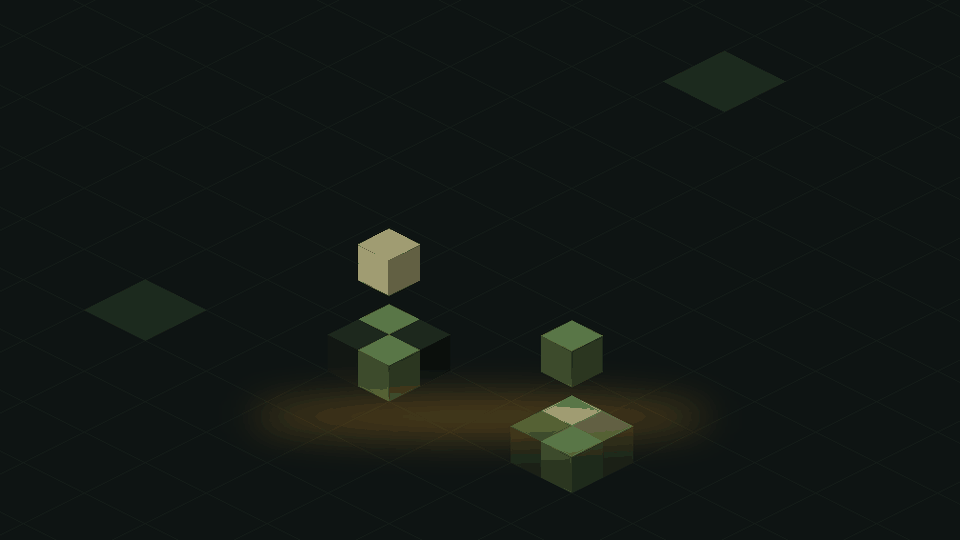
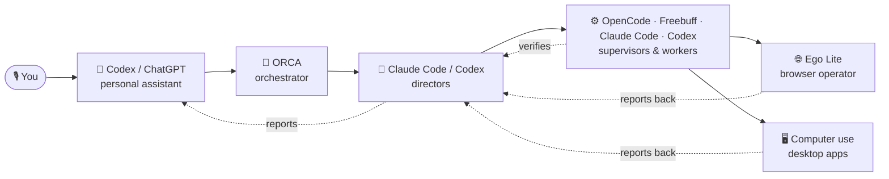
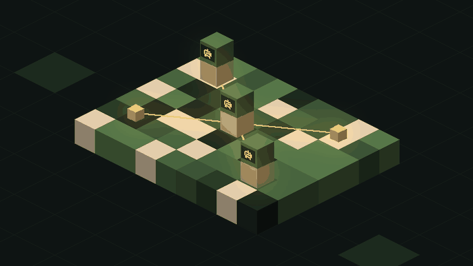
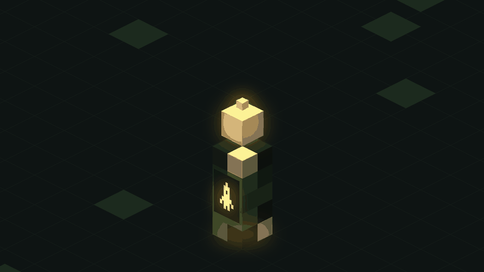

<picture>
  <source media="(prefers-reduced-motion: reduce)" srcset="assets/h-stack-banner.png">
  
</picture>

<p align="center">
  
</p>

<p align="center">
  <a href="https://github.com/EnzoVezzaro/hstack"></a>
  
  <a href="https://github.com/EnzoVezzaro/hstack/releases"></a>
  <a href="LICENSE"></a>
</p>

# HSTACK

**HSTACK** (read "High Stack") is a box of **36 local agent skills** for running a crew of AI agents without babysitting every terminal.

You talk to one assistant. It hands the work down the stack, cheap workers do the heavy lifting, and everything comes back verified. You only step in for the calls that matter.

Every skill is a plain `SKILL.md` file. No plugin, no daemon, no hidden agents. Just blocks you stack.

> **Start here:** say **"use my stack"** to the **Enzo Coding Playbook**. It picks the right skill for your task.

<p align="center">
  <picture>
    <source media="(prefers-reduced-motion: reduce)" srcset="assets/animations/build-h.png">
    
  </picture>
</p>

<p align="center"></p>

## 🧭 The stack (V5)

One voice in, a whole crew out. Watch the gold pulse travel down the layers:

<p align="center">
  <picture>
    <source media="(prefers-reduced-motion: reduce)" srcset="assets/animations/flow-v5.png">
    
  </picture>
</p>



| Layer | Who | Does |
| --- | --- | --- |
| 🧠 1 | Codex / ChatGPT | Talks with you, plans, keeps track of everything |
| 🐋 2 | ORCA | Routes sessions and context |
| 🎯 3 | Claude Code / Codex | Decides, designs, accepts the work |
| ⚙️ 4 | OpenCode / Freebuff / Claude Code / Codex | Codes, debugs, tests, researches |
| 🌐 5 | Ego Lite | Clicks through real websites and web apps |
| 🖥️ 5 | Computer use | Drives native desktop apps (Orca, Codex, or Claude desktop) |

**$40/month** for the whole crew: two $20 subscriptions, everything else open source or free. Details, economics, and the principles live in **[docs/hstack-v5.md](docs/hstack-v5.md)**.

<p align="center"></p>

## 🧰 Skills

<p align="center">
  <picture>
    <source media="(prefers-reduced-motion: reduce)" srcset="assets/animations/coordinate-bots.png">
    
  </picture>
</p>

Pick a shelf. Every skill has a **Say** phrase you can type in your agent.

<details open>
<summary><b>🌅 Daily rhythm</b> (4)</summary>

| Skill | Say | What it does |
| --- | --- | --- |
| [a-new-day](skills/a-new-day/SKILL.md) | `/a-new-day` | Opens the day from live Orca state and the next action. |
| [plan-horizon](skills/plan-horizon/SKILL.md) | `/plan-day`, `/plan-week`, `/plan-month` | Turns priorities into a plan that fits the horizon. |
| [wrap-day](skills/wrap-day/SKILL.md) | `/wrap-day` | Closes the day with verified progress and tomorrow's first step. |
| [blocker-radar](skills/blocker-radar/SKILL.md) | `/any-blockers` | Finds what is stuck, who owns it, and the smallest next move. |

</details>

<details open>
<summary><b>🎛️ Coordination</b> (6)</summary>

| Skill | Say | What it does |
| --- | --- | --- |
| [enzo-coding-playbook](skills/enzo-coding-playbook/SKILL.md) | "use my stack" | The router. Sends a task to the right workflow. |
| [relay-room](skills/relay-room/SKILL.md) | `/relay-room` | Finds the live Orca project and owner, then hands off a bounded task. |
| [coordinate-agents](skills/coordinate-agents/SKILL.md) | `/coordinate-agents` | Dispatches bounded tasks and checks each report against evidence. |
| [handoff](skills/handoff/SKILL.md) | `/handoff` | Writes a self-contained brief so another agent can pick it up cold. |
| [resume-work](skills/resume-work/SKILL.md) | `/resume-work` | "Continue where you left off", verified first. |
| [general-tasks](skills/general-tasks/SKILL.md) | `/general-tasks` | Splits a messy request into ordered steps and routes each one. |

</details>

<details>
<summary><b>🛠️ Build & verify</b> (12)</summary>

| Skill | Say | What it does |
| --- | --- | --- |
| [implement-feature](skills/implement-feature/SKILL.md) | `/implement-feature` | Writes the acceptance check first, then the smallest change. |
| [verify-and-fix](skills/verify-and-fix/SKILL.md) | `/verify-and-fix` | Reproduces, fixes the cause, reruns the same path. |
| [patch-patrol](skills/patch-patrol/SKILL.md) | `/patch-patrol` | Independent review of a diff, against the requested behavior. |
| [save-point](skills/save-point/SKILL.md) | `/save-point` | Compares with the last known-good version and repairs the cause. |
| [research-explain](skills/research-explain/SKILL.md) | `/research-explain` | Searches the web and GitHub, reads the source, explains with evidence. |
| [run-local](skills/run-local/SKILL.md) | `/run-local` | Starts the app, checks the main path, reports the URL. |
| [visual-test-ego-lite](skills/visual-test-ego-lite/SKILL.md) | `/visual-test-ego-lite` | Clicks through the app in Ego Lite the way a person would. |
| [visual-test-computer-use](skills/visual-test-computer-use/SKILL.md) | `/visual-test-computer-use` | Tests native desktop apps with computer use when a browser can't reach them. |
| [interface-check](skills/interface-check/SKILL.md) | `/interface-check` | Inspects a real screen at desktop and phone widths, then retests. |
| [fix-ci](skills/fix-ci/SKILL.md) | `/fix-ci` | Reads the failing logs, fixes the cause, reruns the checks. |
| [setup-install](skills/setup-install/SKILL.md) | `/setup-install` | Installs from the lockfile and configures without leaking secrets. |
| [cleanup-refactor](skills/cleanup-refactor/SKILL.md) | `/cleanup-refactor` | Removes dead code in small steps, tests after each one. |

</details>

<details>
<summary><b>🚢 Ship</b> (5)</summary>

| Skill | Say | What it does |
| --- | --- | --- |
| [publish-git](skills/publish-git/SKILL.md) | `/publish-git` | Commit, push, merge to main. Nothing outward-facing without approval. |
| [deploy](skills/deploy/SKILL.md) | `/deploy <deployment-source>` | Confirms the target and version, deploys, verifies the live result. |
| [product-hunt-launch](skills/product-hunt-launch/SKILL.md) | `/product-hunt-launch` | Drafts the listing and assets. Posts only after you say so. |
| [cleanup-worktrees-branches](skills/cleanup-worktrees-branches/SKILL.md) | `/cleanup-worktrees-branches` | Merges to main, then clears merged worktrees and branches. |
| [cleanup-disk-space](skills/cleanup-disk-space/SKILL.md) | `/cleanup-disk-space` | Finds what eats the disk, deletes only what you approve. |

</details>

<details>
<summary><b>✍️ Content, design & quality</b> (9)</summary>

| Skill | Say | What it does |
| --- | --- | --- |
| [ui-design](skills/ui-design/SKILL.md) | `/ui-design` | Designs or adjusts UI, landing pages, styles, and logos. |
| [antislop-review](skills/antislop-review/SKILL.md) | `/antislop-review` | Flags generic AI patterns in UI, copy, or code. |
| [motion-graphic](skills/motion-graphic/SKILL.md) | `/motion-graphic` | Builds motion graphics and short videos with HyperFrames. |
| [docs-content](skills/docs-content/SKILL.md) | `/docs-content` | Updates docs, product data, and links, verifying every fact. |
| [humanize](skills/humanize/SKILL.md) | `/humanize` | Rewrites AI-sounding text. Keeps every fact. |
| [write-readme-opensource](skills/write-readme-opensource/SKILL.md) | `/write-readme-opensource` | Writes a README and CONTRIBUTING from the real code. |
| [seo-audit](skills/seo-audit/SKILL.md) | `/seo-audit` | Technical SEO audit, ranked by impact. |
| [security-backend](skills/security-backend/SKILL.md) | `/security-backend` | Reviews auth, endpoints, migrations, and exposed keys. |
| [skill-workbench](skills/skill-workbench/SKILL.md) | `/skill-workbench` | Turns a repeated, evidenced task into a new skill. |

</details>

<p align="center"></p>

## 🚀 Install in 30 seconds

<p align="center">
  <picture>
    <source media="(prefers-reduced-motion: reduce)" srcset="assets/animations/ship-launch.png">
    
  </picture>
</p>

```bash
git clone https://github.com/EnzoVezzaro/hstack.git
cp -R hstack/skills/* ~/.codex/skills/     # Codex
cp -R hstack/skills/* ~/.claude/skills/    # Claude Code
```

Restart your agent session so it finds the new blocks. Then try one:

```text
use my stack: reproduce the reported regression, fix the cause, and verify the same path.
/visual-test-ego-lite walk the signup flow on mobile and tell me where a person gets stuck.
/visual-test-computer-use relaunch the desktop app and check the settings window.
/any-blockers check the active Orca projects and name the smallest next move for each blocker.
```

<p align="center"></p>

## 🧩 Requirements

- An agent harness that reads local `SKILL.md` files.
- The source skills some workflows call. Each dependency is listed in [source-skills.md](docs/source-skills.md).
- **Orca** for the coordination and daily skills. Orca is the source of truth for what is actually running.
- **Ego Lite** for browser work.
- **Computer use** for native desktop apps: `orca computer` inside Orca, Codex Computer Use, or Claude desktop.

## 🎨 Make them yours

These are starting points. Put your own settings, such as which agents you run and which deploy targets exist, in your `CLAUDE.md` or `AGENTS.md`. Then update the skills without losing your setup.

## 📚 Docs

- [HSTACK V5 reference](docs/hstack-v5.md): roles, economics, and the skill-to-layer map.
- [Workflows](docs/workflows.md): the twelve core workflows and the added commands.
- [Operating model](docs/role-model.md): the short version of the roles.
- [Animations](scripts/generate_hstack_animations.py): regenerate the voxel GIFs with `python3 scripts/generate_hstack_animations.py`.
- [Workflow map](docs/workflow-map.md) and [skill usage](docs/skill-usage.md): evidence behind the shelves.

## 🙏 Relationship to the references

[P-Stack](https://github.com/cursor/plugins/tree/main/pstack) is the direct reference. HSTACK adopts its named entry router, skills table, install and get-started sections, "make it yours" section, and MIT license. HSTACK omits its `.cursor-plugin/` and `plugin.json`, Cursor plugin commands, `agents/` subagents, `automations/`, model-configuration skill, playbook and principle catalogs, and generated harness trees: this repository has no Cursor integration, bundled agents, automations, or model-configuration skill.

[T-Stack](https://github.com/t3dotgg/tstack) is a structural reference. HSTACK adopts its compact skill table with a "Say" column, the explicit "some skills call others" dependency note, plain `git clone` + `cp` install, a Requirements section, and "Make them yours" pointing to local config. HSTACK omits its GitHub-CLI and PR-centred skills because no such workflow is part of this stack.

---

<p align="center">
  <br>
  <sub>Built with AI, coffee, and a little weed, for people who want to manage software, not every terminal. MIT licensed.</sub>
</p>
