<picture>
  <source media="(prefers-reduced-motion: reduce)" srcset="assets/h-stack-banner.png">
  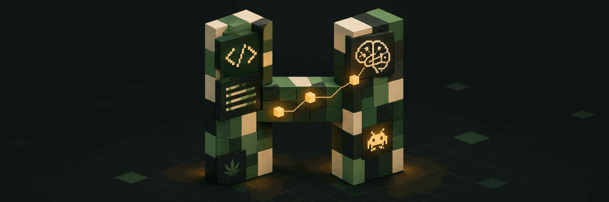
</picture>

<p align="center">
  
</p>

<p align="center">
  
  
  <a href="LICENSE"></a>
</p>

# HSTACK

<p align="center">
  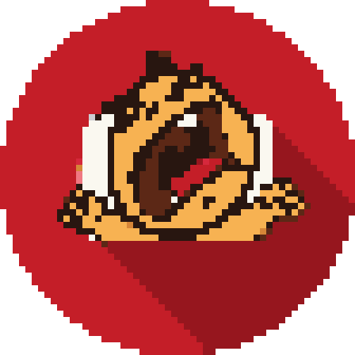<br>
  <sub>by <a href="https://github.com/EnzoVezzaro">Enzo Vezzaro</a></sub>
</p>

I run a small crew of AI agents for $40 a month, or $50 with optional OpenCode Go for director work. One of them listens to me, two of them make the decisions, and a handful of free ones do the typing. It took five versions to get here. Somewhere around the third one, I stopped babysitting terminals and started finishing my coffee while it was still warm. Now I just enjoy it with some green while I talk to Codex / ChatGPT.

HSTACK (read "high stack") is my setup, written down as 62 agent skills for coordinating work across multiple repositories. It runs on one rule: expensive models make decisions and cheap models do the work. The paid models plan and review; the free ones write the code. Nothing gets merged, deployed, or deleted until I say yes.

The skills are plain [Agent Skills](https://agentskills.io), a folder of `skills/<name>/SKILL.md` files, so they work in Claude Code, Codex, OpenCode, Cursor, and most agents that read the format.

## Quick start

Two steps, with a real project named:

```bash
npx skills add EnzoVezzaro/hstack        # pick the skills you want
```

```text
/hstack <project> The signup button does nothing on mobile. Reproduce it, fix it, and show me it works.
```

Use the actual Orca project or repo name in place of `<project>`; for work across repos, name each one. `/hstack` resolves the target worktree, routes to one skill, and keeps the expensive models out of the boring parts. Run `/setup-hstack <project>` once per project so the skills know which agents and models you actually have.

## Install

```bash
npx skills add EnzoVezzaro/hstack
```

The [`skills` CLI](https://skills.sh) lists them; pick the skills and agents you want. Add `-g` to install them for every project instead of just this one.

<details>
<summary>Rather copy the files by hand?</summary>

```bash
git clone https://github.com/EnzoVezzaro/hstack.git
cp -R hstack/skills/* ~/.claude/skills/   # Claude Code
cp -R hstack/skills/* ~/.codex/skills/    # Codex
```

Restart your agent so it notices the new skills. Every skill folder carries its required contract, V5 roles and model-routing references in `references/`, generated from this repository's docs and drift-checked, so a plain copy works without any adjacent docs folder.

For a checked payload, including a single skill, use the installer from a clone:

```bash
git clone https://github.com/EnzoVezzaro/hstack.git
cd hstack
scripts/install/install.sh --all --skills-root ~/.claude/skills
scripts/install/install.sh interface-check --skills-root ~/.claude/skills
```

Installing a skill does **not** install the other skills it mentions, or any external tool. The full per-route list, with bundled, external and optional capabilities and how to obtain them, is in [docs/source-skills.md](docs/source-skills.md). Helper scripts for `/benchmark`, `/token-balancer`, `/resume-all` and validation require this checkout; they are not installed into the skills directory.

</details>

<p align="center">
  <picture>
    <source media="(prefers-reduced-motion: reduce)" srcset="assets/animations/install-terminal.png">
    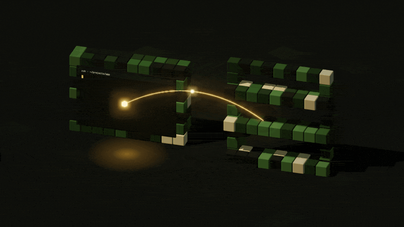
  </picture>
</p>

## What's new in v5.3.0

- H Stack is explicitly multi-repo: name `<project>` in each request, and name every repo when work spans projects.
- `/take-one-dude` drives a request to completion, choosing focused or repeated execution when useful and proving the result with concrete probes.
- `/token-balancer` periodically reviews Orca subscription limits and recommends a model using remaining capacity and observed performance.
- Browser and desktop visual passes now share `/visual-test`, replacing `/visual-test-ego-lite` and `/visual-test-computer-use`.
- OpenCode Go is an optional Director model for an additional $10/month, bringing the crew from $40 to $50/month.
- An animated V1-to-V5 history shows the toolchain, the shift from single-project to mixed to multi-repo scope, and why the final system combines free execution with paid decision models.
- `/benchmark` checks skills and the stack in fresh environments; the first keyless results are in [docs/benchmark-results.md](docs/benchmark-results.md).
- The catalog audit records proposed future consolidation separately from shipped changes.

Release notes: [v5.3.0](https://github.com/EnzoVezzaro/hstack/releases/tag/v5.3.0).

## The skill execution contract

All 62 skills follow the same [HStack execution contract](docs/skill-contract.md): resolve the real project and worktree, use live Orca state only after confirming the runtime, keep one owner per bounded task, verify on the reported revision, and require explicit approval for outward-facing changes. Source-skill names do not mean those tools are installed. If Orca is unavailable, a director brief remains **unsent**, never a fabricated handoff.

See the [60-skill audit from November 22, 2026](docs/skill-audit-2026-11-22.md); `/benchmark` and `/resume-all` were added after it. The current slash commands are preserved; the [consolidation proposal](docs/consolidation-proposal.md) is not a migration.

## Getting started

H Stack is for **multi-repo work**. Name the target project in every request; for work across repos, name each project. `<project>` is a placeholder for the actual Orca project/repo name:

```
/hstack <project> The signup button does nothing on mobile. Reproduce it, fix it, and show me it works.
```

[`/hstack`](skills/hstack/SKILL.md) resolves the named repo/worktree, picks the skill that fits, splits big jobs into steps, and keeps the expensive models away from the boring parts. A cross-repo request names each `<project>` separately. Run [`/setup-hstack`](skills/setup-hstack/SKILL.md) once per project, so it knows which agents and models you actually have.

<details>
<summary>How do skills get picked up?</summary>

Your agent doesn't read 62 instruction files every time it starts. It reads one line per skill, a bit like skimming a menu, and loads the full instructions only when a skill is needed. That happens in one of two ways:

- You call it by name, like `/fix-ci`.
- The agent recognizes the job. Say "CI is red again" and it loads the skill whose description matches.

So installing all 62 costs almost nothing until you use one.

</details>

<p align="center"></p>

## The stack

<p align="center">
  <picture>
    <source media="(prefers-reduced-motion: reduce)" srcset="assets/animations/stack-office.png">
    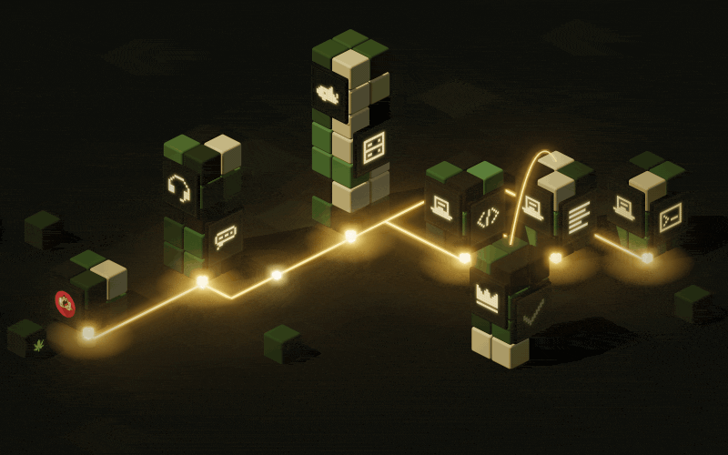
  </picture>
</p>

One voice goes in at the top, and a whole crew answers across your repositories. Orca keeps project context and worktrees distinct; each task must name its target repo:

| Layer | Who | What it does | Cost |
|---|---|---|---|
| 🧠 Assistant | Codex / ChatGPT | Talks with me, plans the day, remembers what I forgot | $20/mo |
| 🐋 Orchestrator | ORCA | Routes sessions, context, and work between agents | Free, open source |
| 🎯 Directors | Claude Code / Codex; optional OpenCode Go. Free mode can use capable OpenCode free models or Freebuff full mode (currently suspended) | Decide, design, and accept or reject the work | $20/mo + optional $10/mo |
| 🧭 Supervisors | Prefer capable free OpenCode models for routine supervision; Freebuff free tiers when available ([benched](#a-note-to-the-freebuff-team)); paid OpenCode Go / Claude Code / Codex only when the task needs it | Split work into bounded tasks and check progress and evidence | Free first, paid when needed |
| ⚙️ Workers | OpenCode, ~~Freebuff~~ ([benched](#a-note-to-the-freebuff-team)), Claude Code, Codex | Write code, debug, test, and research on cheap or free models | Included or free |
| 🌐 Browser | Ego Lite | Clicks through real websites | Free, open source |
| 🖥️ Desktop | Computer use (Orca, Codex, Claude desktop) | Drives native apps | Included |

That's $40 a month for the whole crew, or $50 with optional OpenCode Go for director work. Subscription and free-tier limits apply. API costs, hosting, and the model you forgot to switch off are not included. Costs and the V1-to-V5 history are in [docs/hstack-v5.md](docs/hstack-v5.md).

### How V1 became V5

The scope grew in steps: V1 and V2 ran a single project, V3 mixed single- and multi-project work, and V4 and V5 focus on multi-repo work where every project is named and kept separate. The tools grew with it, from a small agent chain into a routed command system. As the work got harder, repeatable procedures became reusable skills, and stronger models took on the decisions free models could not reliably handle. The human still owns the command center.

<p align="center">
  <picture>
    <source media="(prefers-reduced-motion: reduce)" srcset="assets/animations/evolution-explainer.png">
    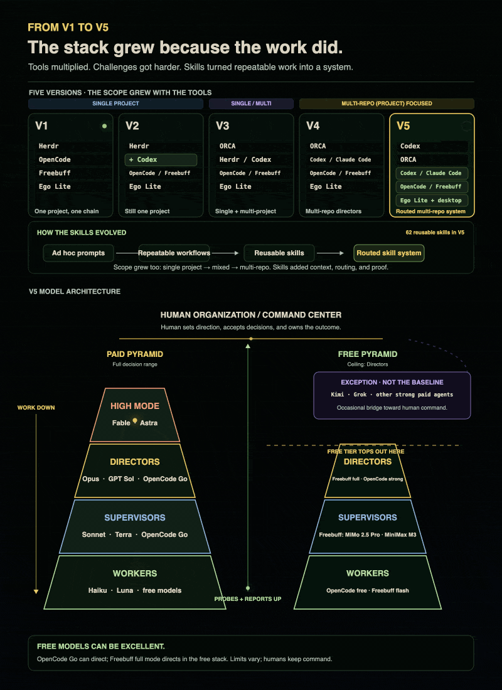
  </picture>
</p>

The house rules:

- Expensive intelligence makes decisions; cheap intelligence does the execution.
- Agents delegate, verify, and report back. "Trust me, it works" gets sent back for proof.
- Humans stay in control. Pushes, merges, deploys, launches, and deletes wait for a yes.
- More agents is not more intelligence. A big crew that shares nothing is just a loud one.

### A note to the Freebuff team

Freebuff carried a lot of the free worker load, and the account was suspended mid-run. The full Thank-you, the suspension notice, and what took its place are in [docs/hstack-v5.md](docs/hstack-v5.md#a-note-to-the-freebuff-team). The short version: OpenCode's free models and NVIDIA's free tier picked up that share.

Prices and model availability change; the figures here describe my setup, not a guarantee of what yours will cost. See [docs/hstack-v5.md](docs/hstack-v5.md) for the economics and [docs/model-routing.md](docs/model-routing.md) for the tier rules.

## The whole map

<details open>
<summary><b>Every layer, every model, and all 62 skills, top to bottom</b></summary>

<p align="center">
  <picture>
    <source media="(prefers-reduced-motion: reduce)" srcset="assets/animations/architecture.png">
    
  </picture>
</p>

<sub>Logos belong to their owners and are only here to show which tool does what.</sub>

</details>

## Cheap first, smart when it matters

<p align="center">
  <picture>
    <source media="(prefers-reduced-motion: reduce)" srcset="assets/animations/tier-pyramid.png">
    
  </picture>
</p>

Every skill starts on the cheapest model that can do the job, and says which tier in its `SKILL.md`:

| Tier | Name | Anthropic | OpenAI | Also works |
|---|---|---|---|---|
| You | Owner | | | Approve, decide, own the product |
| ChatGPT | Main coordinator and assistant | | | Talks to you, plans the day, routes work down |
| T3 | High mode | Fable | Astra | |
| T2 | Directors | Opus | GPT Sol | OpenCode Go (optional) |
| T1 | Supervisors | Sonnet | Terra | Capable free OpenCode models (prefer); OpenCode Go (optional, paid) |
| T0 | Workers | Haiku | Luna | OpenCode Go or free models |

OpenCode Go can work at any tier: director, supervisor or worker. Use the cheapest capable tier for the task. For routine supervision prefer a capable free OpenCode model, check availability live, and use paid supervision only when the task needs it. Freebuff free models are an option when that account is active, but it is currently suspended for me; in the free stack, workers use free tiers and a strong OpenCode model can direct.

The tiers are jobs, not brands. With GLM (Z.ai), DeepSeek, Kimi or any other provider: strongest model to high mode, flagship to directors, mid-size to supervisors, fast or flash to workers. Leave a tier to a different provider if yours has no good fit there.

<p align="center">
  <picture>
    <source media="(prefers-reduced-motion: reduce)" srcset="assets/animations/providers.png">
    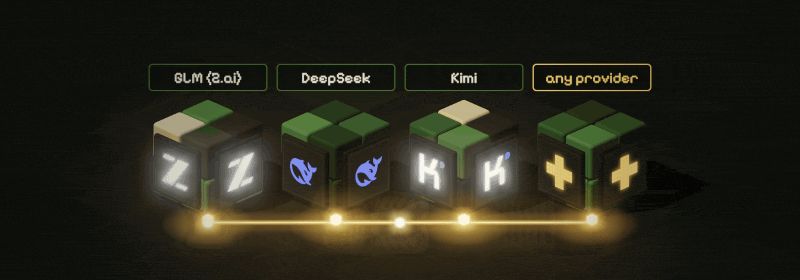
  </picture>
</p>

A job moves up one tier when the same brief fails twice, or when it touches architecture, security, money, or deleting things. Once the smarter model has written the plan, the job goes back down, because thinking is expensive and typing is cheap. Whoever checks the work is never the one who wrote it, since everybody grades their own homework an A.

<p align="center">
  <picture>
    <source media="(prefers-reduced-motion: reduce)" srcset="assets/animations/tier-elevator.png">
    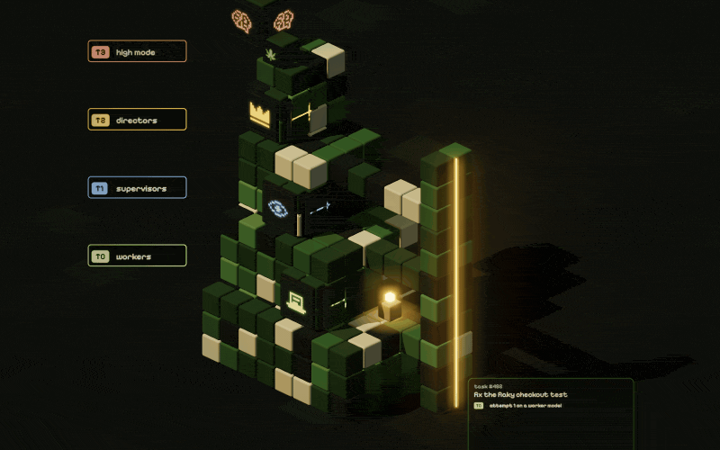
  </picture>
</p>

A task fails twice with the workers, rides up, fails again, gets a plan from the directors, and comes back down to be finished by a worker. High mode naps through all of it. The full rules are in [docs/model-routing.md](docs/model-routing.md).

<details>
<summary><b>The zero-dollar version: OpenCode and Freebuff only</b></summary>

<p align="center">
  <picture>
    <source media="(prefers-reduced-motion: reduce)" srcset="assets/animations/tier-pyramid-free.png">
    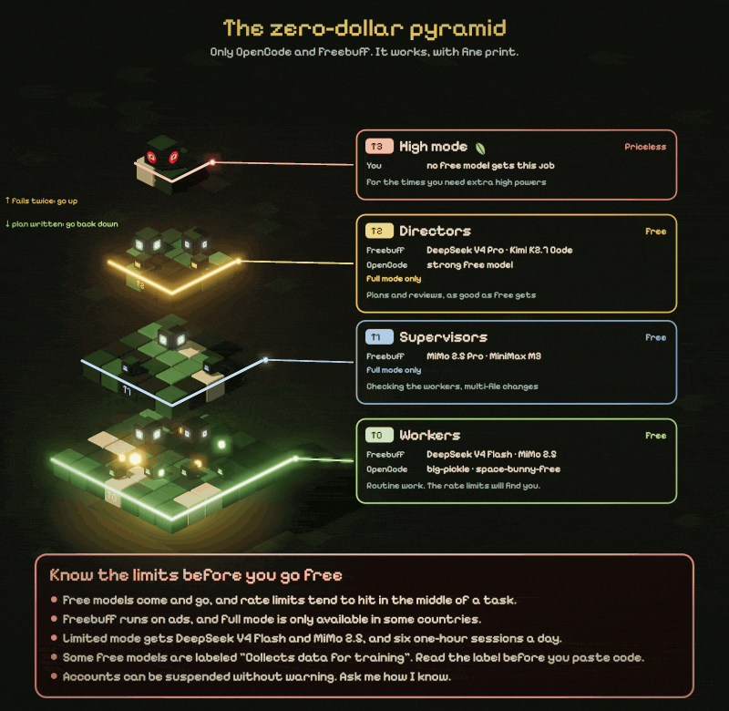
  </picture>
</p>

It works, with fine print:

- Free models come and go, and rate limits tend to hit in the middle of a task.
- Freebuff runs on ads, and full mode is only available in some countries.
- Limited mode gets DeepSeek V4 Flash and MiMo 2.5, and six one-hour sessions a day.
- Some free models are labeled "Collects data for training". Read the label before you paste code.
- Accounts can be suspended without warning. [Ask me how I know](#a-note-to-the-freebuff-team).

</details>

<p align="center"></p>

## Stoner mode

Some days you want to point the crew at your repos and go do something else. [`/stoner`](skills/stoner/SKILL.md) is for those days. It scans every Orca repo, checks the open PRs on each one, ranks the work, and keeps agents on it until the queue is empty. Then it checks the PRs again, because by then someone has opened a new one.

<p align="center">
  <picture>
    <source media="(prefers-reduced-motion: reduce)" srcset="assets/animations/stoner-mode.png">
    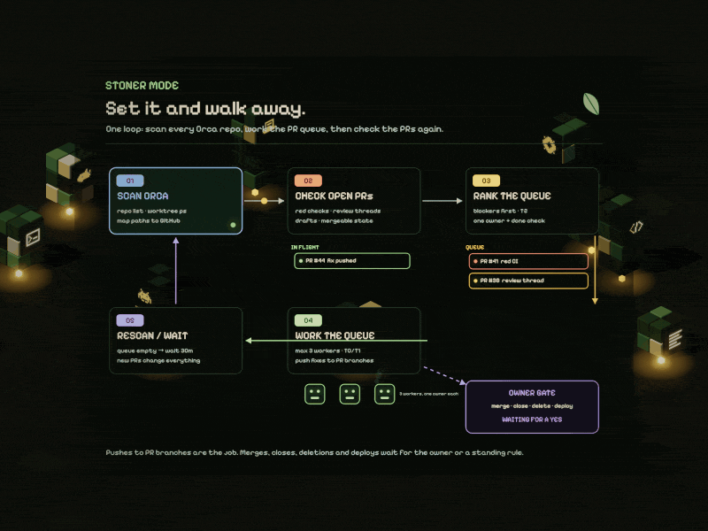
  </picture>
</p>

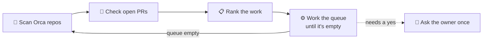

It pushes fixes to each PR's own branch without asking, because that's the job you gave it. It doesn't merge into main, close PRs, delete branches, or deploy unless you say yes or leave a standing rule in `AGENTS.md`:

```markdown
## stoner
- max workers: 3
- auto-merge: green-and-approved
- idle wait: 30
- stop after: 8 hours
```

`coordinate-agents`, `fix-ci`, `puff-puff-pass`, and `reconcile-branches` take turns, escalating by the tier rules. It stops when you tell it to, when the budget runs out, or when there's genuinely nothing left to do. Then it waits quietly and checks again.

<p align="center"></p>

## Skills

<p align="center">
  <picture>
    <source media="(prefers-reduced-motion: reduce)" srcset="assets/animations/ship-pipeline.png">
    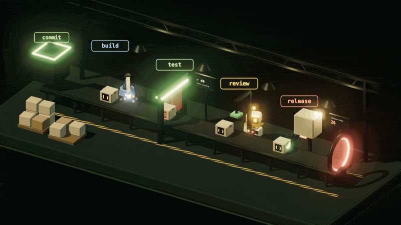
  </picture>
</p>

<details open>
<summary><b>🌅 Daily rhythm</b></summary>

| Skill | Use it when |
|---|---|
| [`/a-new-day`](skills/a-new-day/SKILL.md) | It's morning. Pulls live Orca state and recent work, and hands you the first move of the day. |
| [`/plan-horizon`](skills/plan-horizon/SKILL.md) | You want a plan that actually fits in a day, a week, or a month (`/plan-day`, `/plan-week`, `/plan-month`). |
| [`/wrap-day`](skills/wrap-day/SKILL.md) | You're logging off and want to know what really got done, what's stuck, and where tomorrow starts. |
| [`/blocker-radar`](skills/blocker-radar/SKILL.md) | Something is stuck and you'd like a name and a next step rather than a vibe (`/any-blockers`). |

</details>

<details open>
<summary><b>🎛️ Running the crew</b></summary>

| Skill | Use it when |
|---|---|
| [`/relay-room`](skills/relay-room/SKILL.md) | The work belongs to a live Orca project and a director needs a short, clear brief. |
| [`/coordinate-agents`](skills/coordinate-agents/SKILL.md) | Several agents need work, and every "all done!" they send back needs checking. |
| [`/resume-all`](skills/resume-all/SKILL.md) | Checks every Orca project, resumes only genuinely interrupted sessions on an equally capable model, and continues with a handoff and a probe; [latest scan](docs/orca-resume-scan.md). |
| [`/resume-work`](skills/resume-work/SKILL.md) | You typed "continue". It checks what actually got done before it believes anyone. |
| [`/handoff`](skills/handoff/SKILL.md) | Another agent should take over. Writes a brief they can pick up cold, with no backstory required. |
| [`/setup-hstack`](skills/setup-hstack/SKILL.md) | It's your first install. Finds your agents and models and writes your tier map to `AGENTS.md`. |
| [`/token-balancer`](skills/token-balancer/SKILL.md) | Checks available Orca subscription limits across named projects and recommends a model for the next task, with evidence. |
| [`/benchmark`](skills/benchmark/SKILL.md) | Measures skill quality, harness loading and routing in fresh environments; [results](docs/benchmark-results.md) and the [matrix](docs/benchmark.md) stay explicit about what was not run. |

</details>

<p align="center">
  <picture>
    <source media="(prefers-reduced-motion: reduce)" srcset="assets/animations/horizon-loop.png">
    
  </picture>
</p>

<details open>
<summary><b>🌀 Long-horizon work</b></summary>

| Skill | Use it when |
|---|---|
| [`/stoner`](skills/stoner/SKILL.md) | You want to walk away. Checks every Orca repo's PRs, works the queue until it's empty, then starts over. See [Stoner mode](#stoner-mode). |
| [`/break-it-down`](skills/break-it-down/SKILL.md) | The task is too big for one session. Splits it into small pieces that can each be checked, with an order and a tier for each. |
| [`/horizon`](skills/horizon/SKILL.md) | The job takes weeks. Sets up a schedule (a Codex automation by default) with an end date and a progress log. |
| [`/horizon-loop`](skills/horizon-loop/SKILL.md) | You want something repeated until a number is hit. Measure, change one thing, and keep it only if it helped. |
| [`/horizon-loop-test`](skills/horizon-loop-test/SKILL.md) | The test suite needs to get green and stay green. One failure at a time, and no test gets quietly "adjusted". |
| [`/horizon-loop-ego-lite`](skills/horizon-loop-ego-lite/SKILL.md) | Real browser flows have to pass N times in a row in Ego Lite before anyone calls it fixed. |

</details>

<details>
<summary><b>🛠️ Build and fix</b></summary>

| Skill | Use it when |
|---|---|
| [`/implement-feature`](skills/implement-feature/SKILL.md) | You want a feature. Writes the acceptance check first, then the smallest change that passes it. |
| [`/take-one-dude`](skills/take-one-dude/SKILL.md) | Give one agent a project task to own end to end: move quickly, choose a bounded loop or more effort only when needed, and prove the finish with concrete probes. |
| [`/verify-and-fix`](skills/verify-and-fix/SKILL.md) | Something broke, or a change needs proving. Reproduces it, fixes the cause, and reruns the exact same path. |
| [`/save-point`](skills/save-point/SKILL.md) | It worked last week. Compares with the last good version and repairs whatever changed. |
| [`/patch-patrol`](skills/patch-patrol/SKILL.md) | A diff needs a second pair of eyes that didn't write it. |
| [`/check-github`](skills/check-github/SKILL.md) | You want repos, code, or issues found on GitHub and compared, with links. |
| [`/research-explain`](skills/research-explain/SKILL.md) | You have a question about a library, a market, or why this code is the way it is. |
| [`/fix-ci`](skills/fix-ci/SKILL.md) | CI is red. Reads the failing step and fixes the cause. Disabling the check doesn't count. |
| [`/setup-install`](skills/setup-install/SKILL.md) | A project needs installing or configuring, and your secrets should stay out of files and chat. |
| [`/cleanup-refactor`](skills/cleanup-refactor/SKILL.md) | Dead code has to go, in small steps, with the tests run after each one. |

</details>

<details>
<summary><b>👀 Eyes on real screens</b></summary>

| Skill | Use it when |
|---|---|
| [`/run-local`](skills/run-local/SKILL.md) | You want it running on localhost and the URL back, minus the "works on my machine" speech. |
| [`/visual-test`](skills/visual-test/SKILL.md) | A website or native app needs clicking through the way a person would: Ego Lite for browsers, computer use for Mac, Electron, Tauri, or desktop apps. |
| [`/interface-check`](skills/interface-check/SKILL.md) | A screen needs a UI pass at desktop and phone widths, with screenshots instead of opinions. |

</details>

<details>
<summary><b>🚀 Ship it</b></summary>

Where it lands is a choice, not a built-in: GitHub releases, Vercel, AWS, Google Cloud, Cloudflare, npm, or whatever the project documents. `/deploy` confirms the target platform and the exact version before anything goes out, then checks the live result.

| Skill | Use it when |
|---|---|
| [`/reconcile-branches`](skills/reconcile-branches/SKILL.md) | Several branches and worktrees want into main. Tests every merge first, plans the order, rehearses it, and lands it after your yes. |
| [`/release`](skills/release/SKILL.md) | It's release time. Picks the next version, writes the changelog from what actually changed, tags it, and publishes the GitHub release. |
| [`/publish-git`](skills/publish-git/SKILL.md) | Commit, push, merge. Asks before anything leaves your machine. |
| [`/deploy`](skills/deploy/SKILL.md) | `/deploy <deployment-source>`. Confirms the target and version, deploys, then checks the live site runs that version. |
| [`/set-analytics`](skills/set-analytics/SKILL.md) | You'd like to know if anyone uses the thing. Installs PostHog (by default), plans the first events, adds a proxy and consent, and checks real events arrive. |
| [`/product-hunt-launch`](skills/product-hunt-launch/SKILL.md) | It's launch day. Drafts the listing and the assets, and posts only when you say go. |

</details>

<details open>
<summary><b>🧹 Housekeeping</b></summary>

| Skill | Use it when |
|---|---|
| [`/cleanup-orca`](skills/cleanup-orca/SKILL.md) | Your Orca sidebar looks like a browser with 80 tabs. Merges what it can, closes what's done, and keeps anything with unmerged work. |
| [`/cleanup-chats`](skills/cleanup-chats/SKILL.md) | Codex and ChatGPT are full of finished threads. Carries the loose ends into one brief per project, then archives the rest. |
| [`/cleanup-worktrees-branches`](skills/cleanup-worktrees-branches/SKILL.md) | You want everything merged to main and the leftover worktrees and branches gone. |
| [`/cleanup-disk-space`](skills/cleanup-disk-space/SKILL.md) | Your disk is full. (Mine filled up while these animations were rendering.) Measures first and deletes only what you approve. |

</details>

<details>
<summary><b>✍️ Words, design, and quality</b></summary>

| Skill | Use it when |
|---|---|
| [`/ui-design`](skills/ui-design/SKILL.md) | You want a UI, a landing page, or a logo designed or fixed. |
| [`/antislop-review`](skills/antislop-review/SKILL.md) | It looks like every other AI-generated landing page, gradient included. |
| [`/motion-graphic`](skills/motion-graphic/SKILL.md) | You want an animated explainer or a short video, built with HyperFrames. |
| [`/humanize`](skills/humanize/SKILL.md) | The text reads like a chatbot on its third espresso. Rewrites it and keeps every fact. |
| [`/docs-content`](skills/docs-content/SKILL.md) | Docs, product data, or links have drifted away from reality. |
| [`/write-readme-opensource`](skills/write-readme-opensource/SKILL.md) | A project is going public and needs a README and CONTRIBUTING written from the real code. |
| [`/seo-audit`](skills/seo-audit/SKILL.md) | Search can't find you, and you'd like to know why, ranked by how much it hurts. |
| [`/security-backend`](skills/security-backend/SKILL.md) | Auth, endpoints, migrations, infra, or a key that ended up somewhere it shouldn't. Starts on a top-tier model. |
| [`/skill-workbench`](skills/skill-workbench/SKILL.md) | You keep asking for the same thing. Turns it into a skill so you can stop asking. |

</details>

<details open>
<summary><b>🎧 Coding, weed, and music</b></summary>

| Skill | Use it when |
|---|---|
| [`/420`](skills/420/SKILL.md) | It's time for a new sesh. Starts your music (Apple Music or YouTube), opens the ChatGPT app with [Oreja](https://github.com/EnzoVezzaro/oreja) so the music steps aside whenever ChatGPT talks, and lines up the first task. |
| [`/let-me-watch`](skills/let-me-watch/SKILL.md) | You want to see it running. Opens the local site, the desktop app, or an emulator with the project already up. |
| [`/get-stoned`](skills/get-stoned/SKILL.md) | You need new ideas or a strange way out of something stuck. Flips the assumptions, scores every idea, and picks a few worth prototyping. |
| [`/haf`](skills/haf/SKILL.md) | You want unusual UI inspiration. Hunts Awwwards, Codrops, Dribbble, Pinterest, and CodePen, and comes back with annotated references. |
| [`/puff-puff-pass`](skills/puff-puff-pass/SKILL.md) | You want it built on a cheap model and reviewed by a stronger, different one before it ships. |
| [`/pineapple-express`](skills/pineapple-express/SKILL.md) | You're done for the day. Closes what can be closed, parks the rest with handoffs, and stops the processes your agents left running. So I can go to watch netflix and chill. |

</details>

<details open>
<summary><b>🧩 My own tools, wired in</b></summary>

| Skill | Use it when |
|---|---|
| [`/acc-context`](skills/acc-context/SKILL.md) | The repo uses [ACC](https://github.com/EnzoVezzaro/agents-code-context), or should. Agents get focused context and shared memory instead of relearning your codebase every morning. |
| [`/protect-repo`](skills/protect-repo/SKILL.md) | A repo is going public. [Repo Shield](https://github.com/EnzoVezzaro/repo-shield) opens a PR with a license, an AI-training notice, and a weekly watch. |
| [`/reposell-release`](skills/reposell-release/SKILL.md) | You want to sell a repo. [reposell](https://github.com/EnzoVezzaro/reposell) runs the audit and the gates, and publishes when you say yes. |
| [`/proagent-equip`](skills/proagent-equip/SKILL.md) | A cheap worker needs to act like a specialist. [ProAgents](https://github.com/EnzoVezzaro/proagents) gives it a professional profile. |
| [`/ace-workspace`](skills/ace-workspace/SKILL.md) | You're setting up a crew across several projects. [ACE](https://github.com/EnzoVezzaro/ace-proagents) creates the governor, supervisors, workers, and budget. |

</details>

### Examples

```
bug:          /hstack <project> The feed jumps every few seconds. Reproduce it first, then fix and verify.
fast pass:    /take-one-dude <project> Fix the signup flow and prove it works end to end.
multi-repo:   /hstack <project-a>, <project-b> Update the shared API contract, then verify each consumer repo separately.
crew:         /coordinate-agents <project-a>, <project-b> Check each project's workers and give them the next tasks.
continue:     /resume-work
handoff:      /handoff <project> Give this branch to an OpenCode worker so they can finish the tests.
stoner:       /stoner Work through every open PR. Don't merge anything into main without me.
big task:     /break-it-down <project> Migrate the store to the new API.
long run:     /horizon <project> Review the backlog every morning until December 15. Stay quiet if nothing changed.
loop:         /horizon-loop <project> Get the landing page Lighthouse score above 95.
tests:        /horizon-loop-test <project> Get every test green and keep it green for five runs in a row.
browser:      /visual-test <project> Walk the checkout on mobile in Ego Lite and tell me where a person gets stuck.
desktop:      /visual-test <project> Use computer use: kill the old builds, install the new one, and test the settings window.
merge:        /reconcile-branches Get every open worktree that's ready into main.
orca:         /cleanup-orca Merge what you can and close as much as possible.
chats:        /cleanup-chats Archive the finished Codex threads and keep the open items.
release:      /release <project>
deploy:       /deploy <project> main
analytics:    /set-analytics <project> PostHog, EU region, session replay only after cookie consent.
launch:       /product-hunt-launch <project> Draft everything for Tuesday. Don't post.
words:        /humanize <project> the launch post.
ideas:        /get-stoned <project> How could onboarding work without a signup form?
inspiration:  /haf <project> Scroll-driven landing pages with 3D type, for a developer tool.
review:       /puff-puff-pass <project> Add rate limiting to the public API.
new sesh:     /420
watch:        /let-me-watch <project> The mobile app, on the Android emulator.
wind down:    /pineapple-express
```

<p align="center"></p>

## Some skills call others

Install these together:

| Skill | Also install |
|---|---|
| `implement-feature` | `verify-and-fix` |
| `verify-and-fix` | `patch-patrol`, `save-point` |
| `coordinate-agents` | `relay-room`, `verify-and-fix`, `publish-git`, `proagent-equip`, `ace-workspace` |
| `publish-git`, `deploy`, `fix-ci`, `cleanup-refactor`, `security-backend` | `verify-and-fix` |
| `reconcile-branches` | `verify-and-fix`, `cleanup-worktrees-branches` |
| `cleanup-worktrees-branches` | `reconcile-branches` |
| `cleanup-orca` | `reconcile-branches`, `handoff` |
| `cleanup-chats` | `acc-context` (when a repo has `.acc/`) |
| `pineapple-express` | `handoff`, `wrap-day`, `cleanup-orca`, `cleanup-chats` |
| `visual-test` | `run-local`, `verify-and-fix` |
| `horizon` | `break-it-down` |
| `horizon-loop-test`, `horizon-loop-ego-lite` | `horizon-loop`, `verify-and-fix` |
| `release` | `verify-and-fix`, `humanize` |
| `puff-puff-pass` | `implement-feature`, `patch-patrol`, `publish-git` |
| `ui-design`, `haf` | `interface-check`, `ui-design` |
| `product-hunt-launch` | `humanize`, `motion-graphic`, `ui-design` |
| `write-readme-opensource`, `reposell-release` | `protect-repo` |
| `implement-feature`, `resume-work`, `handoff` | `acc-context` (when a repo has `.acc/`) |
| `stoner` | `coordinate-agents`, `fix-ci`, `verify-and-fix`, `puff-puff-pass`, `reconcile-branches`, `break-it-down`, `handoff`, `horizon` |
| `420` | `resume-work`, `let-me-watch` |
| `let-me-watch` | `run-local` |
| `set-analytics` | `run-local`, `publish-git` |
| `hstack` | Everything it routes to |

## Not shipped here

A few skills lean on skills that live elsewhere. When one is missing, the skill says so instead of faking it:

- `ego-browser` (Ego Lite), `orca-cli`, `orchestration`, and `orca-computer-use` for the crew and the screens.
- The `antislop` family and `impeccable` for design and writing checks.
- The `hyperframes` family and `media-use` for `motion-graphic`.
- `humanizer` for `humanize`, plus `copywriting` and `copy-editing` from [marketingskills](https://github.com/coreyhaines31/marketingskills) for launch copy.
- `skill-creator` for `skill-workbench`.
- The PostHog wizard (`npx @posthog/wizard@latest`), or the PostHog MCP when it's connected, for `set-analytics`.
- The `acc`, `rs`, `reposell`, `proagent`, and `ace-proagents` CLIs for my own tools. Each skill installs its CLI from npm when it's missing.

Where each one was found, and what it adds: [docs/source-skills.md](docs/source-skills.md).

<p align="center"></p>

## Make it yours

This is my setup. Yours will have different agents, different models, and probably a different snack drawer.

- Write your crew into `CLAUDE.md` or `AGENTS.md`: which agents, which free models, which deploy targets, what budget. The skills read it, so you can update HSTACK without losing your settings.
- Running one agent without Orca? Most skills still work. The crew and daily ones want Orca; the rest only need a repo.
- If you catch yourself asking for the same thing three times, `/skill-workbench` turns it into a skill.

### How the animations are made

Every animation on this page is rendered from code. Each scene is a small Three.js file in [`scripts/animations/src/scenes`](scripts/animations/src/scenes), drawn in headless Chrome with soft shadows and bloom, then encoded to GIF with ffmpeg and gifsicle. To render them yourself:

```bash
cd scripts/animations
npm install
npm run render            # every scene
npm run render -- tier-elevator --frames 48   # one scene, shorter
```

It needs Google Chrome (or `CHROME=/path/to/chrome`), ffmpeg, Python 3 with numpy and Pillow, and optionally gifsicle. The code on the monitors is real; it's the routing logic from this README. Brand marks in the map come from [Simple Icons](https://simpleicons.org) (CC0) or from each app's own icon, and they belong to their owners.

## Docs

- [docs/hstack-v5.md](docs/hstack-v5.md): roles, economics, my own tools, and which layer runs each skill.
- [docs/model-routing.md](docs/model-routing.md): the tiers and when a job moves up or down.
- [docs/workflows.md](docs/workflows.md): the workflows these skills came from.
- [docs/role-model.md](docs/role-model.md): the short version of the roles.
- [docs/workflow-map.md](docs/workflow-map.md) and [docs/skill-usage.md](docs/skill-usage.md): the evidence behind all of it.

## Credits

Huge thanks to [Theo](https://github.com/t3dotgg), for [tstack](https://github.com/t3dotgg/tstack), and to [Poteto](https://github.com/poteto), for [pstack](https://github.com/cursor/plugins/tree/main/pstack), for everything they share with the rest of us, and for being great engineers who helped pioneer vibe coding, better known these days as agentic coding.

## License

[MIT](LICENSE)

<p align="center">
  <br>
  <sub>Built with AI, coffee, and a little weed.</sub>
</p>
