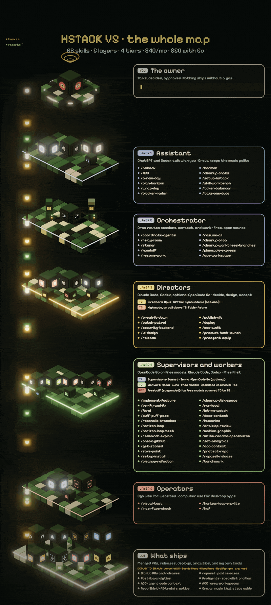

# HStack V5

HStack is the multi-agent setup described in the V5 post ("My AI Degen Stack V5"). This document is the reference for that setup: the roles, the economics, the principles, and which skill does what in it. [role-model.md](role-model.md) holds the short operating model; this file adds the detail.

The skills in this repo are local `SKILL.md` files. Nothing here proves that a given agent or model is running right now. Check live assignments in Orca before treating the roles as the current runtime.

H Stack is a **multi-repo infrastructure**: Orca coordinates distinct projects, repositories, and worktrees. Every code task names its `<project>`; multi-repo tasks list all projects and keep their context, ownership, and acceptance checks separate. Subscription limits and model recommendations are observations per provider/account, then matched to each project's next task; see [`token-balancer`](../skills/token-balancer/SKILL.md).

## Operating contract

Every published skill follows the [HStack execution contract](skill-contract.md). V5 roles and model tiers define responsibilities, **not** proof of active Orca sessions, connected tools, or available models. See the [catalog audit](skill-audit-2026-11-22.md) for the 60 routes it covered and the scope of static versus runtime verification; `/benchmark` and `/resume-all` were added afterwards.

## Evolution

The diagram below tells the story at two scales: the scope grows from one project to many repos, and the tools and workflows grow with it. V5 then splits routine work across a broad free-model base while reserving stronger paid models for the hardest decisions. The history table records the tool chains and project scope; the skills progression is a conceptual summary of how repeatable work became reusable, routed procedures, not a claim about exact skill counts in each historical version.

| Version | Scope | Tool chain |
| --- | --- | --- |
| V1 | Single project | Herdr → OpenCode / Freebuff → Ego Lite |
| V2 | Single project | Herdr → Codex → OpenCode / Freebuff → Ego Lite |
| V3 | Mixed single / multi-project | ORCA → Herdr → Codex → OpenCode / Freebuff → Ego Lite |
| V4 | Multi-repo (project) focused | ORCA → Codex / Claude Code → OpenCode / Freebuff → Ego Lite |
| **V5** | **Multi-repo (project) focused** | **Codex → ORCA → Codex / Claude Code → OpenCode / Freebuff → Ego Lite + computer use** |

The scope moved in three steps: V1–V2 ran one project, V3 mixed one-project and multi-project work, and V4–V5 focus on multi-repo work where each project is named and kept separate. Across those versions, the system's challenges called for more than a prompt and a free worker: reusable skills capture repeatable procedures, route work across repositories, and ask for probes before calling a task done. Free models can produce very good results, but reach director-level organization only sometimes. Paid models provide a more dependable path for the most demanding planning and review; Kimi, Grok, and other unusually capable paid agents are occasional exceptions, while humans retain organization and command-center authority.

## Roles

| Layer | Tool | Role | Does | Model tier |
| --- | --- | --- | --- | --- |
| 1 | Codex / ChatGPT Plus | Personal assistant | Voice commands, conversation, planning, project tracking, reports to the owner | Paid |
| 2 | Orca (open source) | Orchestrator | Agent sessions, context, routing, coordination, work allocation | Free (tool) |
| 3 | Claude Code / Codex / OpenCode Go; in free mode Freebuff full mode (currently suspended) or a strong OpenCode model | Directors | Complex reasoning, architecture, delegation, product decisions, acceptance criteria | Paid, or free mode when available |
| 4 | OpenCode Go or free models / Claude Code / Codex; Freebuff free tiers (suspended for now) | Supervisors | Break work into bounded tasks, check progress and evidence, and return results to directors | Free or paid, by task |
| 4 | OpenCode Go or free models / Claude Code / Codex; Freebuff free tiers (suspended for now) | Workers | Implement, debug, test, research, and execute bounded tasks | Free models for routine work |
| 5 | Ego Lite (open source) | Browser operator | Navigate websites and web apps, collect information, test real workflows | Free (tool) |
| 5 | Computer use (Orca `orca computer`, Codex Computer Use, Claude desktop) | Computer operator | Drive native desktop apps and windows a browser tool cannot reach | Included with the tools above |

Principles from the post:

- Expensive intelligence makes decisions. Cheap intelligence handles execution.
- Agents delegate, verify, and report back.
- Humans stay in control.
- More agents is not more intelligence. The goal is to share context, coordinate decisions, delegate, verify, and stay within token budgets.

## Escalating and downgrading

Every skill starts at the cheapest of four tiers that can do the work (workers, supervisors, directors, high mode) and moves up one tier only on repeated failure or high stakes, then hands execution back down. The tiers, defaults, and rules are in [model-routing.md](model-routing.md); `/setup-hstack` writes your own map.

## Own products in the stack

| Product | What it adds | Skill |
| --- | --- | --- |
| [ACC](https://github.com/EnzoVezzaro/agents-code-context) | Repos that explain themselves to agents (`AGENTS.md` + `.acc/`), focused context, durable memory | `acc-context` |
| [Repo Shield](https://github.com/EnzoVezzaro/repo-shield) | License, AI-training notice, policy, and a weekly watch | `protect-repo` |
| [reposell](https://github.com/EnzoVezzaro/reposell) | Signed paid releases and listings with Stripe Payment Links | `reposell-release` |
| [ProAgents](https://github.com/EnzoVezzaro/proagents) | Professional profiles that make a cheap worker act like a specialist | `proagent-equip` |
| [ACE](https://github.com/EnzoVezzaro/ace-proagents) | Crew workspaces: governor, supervisors, workers, budget | `ace-workspace` |
| [Oreja](https://github.com/EnzoVezzaro/oreja) | Pauses or lowers the music while ChatGPT or another chosen app is talking | `420` |

## Economics (from the post)

| Item | Cost |
| --- | --- |
| Codex / ChatGPT Plus | $20/month |
| Claude Code / Claude Pro | $20/month |
| OpenCode Go (optional for director work) | $10/month additional |
| ORCA | Open source |
| Ego Lite | Open source |
| OpenCode | Open source, with free models |
| Freebuff | Account suspended for now ([the story](../README.md#a-note-to-the-freebuff-team)) |
| **Total** | **$40/month base; $50/month with optional OpenCode Go** (subscription and free-tier limits apply; API costs, hosting, and extra usage are not included) |

Prices are as stated in the post. Verify current pricing before relying on them.

## Command map by role

The catalog separates commands by the layer that primarily runs them. Director commands cover planning, decisions, review, and acceptance; supervisor commands coordinate bounded tasks and check evidence; worker commands perform bounded execution and probes. Cross-layer workflows appear in their own table so a handoff between director and worker stays explicit. Assistant, Orca, and browser or desktop operator commands have a separate table. OpenCode Go can serve at any tier; in free mode, capable OpenCode free models and Freebuff full-mode models can also direct when available. Freebuff is currently suspended for this stack.

### Director commands · Layer 3

| Skill | Command | Layer that runs it | Decision owner |
| --- | --- | --- | --- |
| [seo-audit](../skills/seo-audit/SKILL.md) | `/seo-audit` | 3 | Owner |
| [product-hunt-launch](../skills/product-hunt-launch/SKILL.md) | `/product-hunt-launch` | 3 drafts | Owner approves posting |
| [publish-git](../skills/publish-git/SKILL.md) | `/publish-git` | 3 | Owner approves push and merge |
| [deploy](../skills/deploy/SKILL.md) | `/deploy <deployment-source>` | 3 | Owner approves destination platform, target, and version |
| [security-backend](../skills/security-backend/SKILL.md) | `/security-backend` | 3 | Owner |
| [break-it-down](../skills/break-it-down/SKILL.md) | `/break-it-down` | 3 | Layer 3 |
| [release](../skills/release/SKILL.md) | `/release` | 3 | Owner approves the tag |

### Supervisor commands · Layer 4

| Skill | Command | Layer that runs it | Decision owner |
| --- | --- | --- | --- |
| [verify-and-fix](../skills/verify-and-fix/SKILL.md) | `/verify-and-fix` | 4 supervisor | Layer 3 |

### Worker commands · Layer 4

| Skill | Command | Layer that runs it | Decision owner |
| --- | --- | --- | --- |
| [implement-feature](../skills/implement-feature/SKILL.md) | `/implement-feature` | 4 worker | Layer 3 approves the acceptance check |
| [save-point](../skills/save-point/SKILL.md) | `/save-point` | 4 | Layer 3 |
| [run-local](../skills/run-local/SKILL.md) | `/run-local` | 4 | Layer 3 |
| [antislop-review](../skills/antislop-review/SKILL.md) | `/antislop-review` | 4 | Layer 3 |
| [motion-graphic](../skills/motion-graphic/SKILL.md) | `/motion-graphic` | 4 | Layer 3 |
| [docs-content](../skills/docs-content/SKILL.md) | `/docs-content` | 4 drafts, 1 checks facts | Owner |
| [humanize](../skills/humanize/SKILL.md) | `/humanize` | 4 | Owner |
| [write-readme-opensource](../skills/write-readme-opensource/SKILL.md) | `/write-readme-opensource` | 4 | Owner |
| [setup-install](../skills/setup-install/SKILL.md) | `/setup-install` | 4 | Layer 3 |
| [fix-ci](../skills/fix-ci/SKILL.md) | `/fix-ci` | 4 | Layer 3 |
| [cleanup-refactor](../skills/cleanup-refactor/SKILL.md) | `/cleanup-refactor` | 4 | Layer 3 |
| [cleanup-disk-space](../skills/cleanup-disk-space/SKILL.md) | `/cleanup-disk-space` | 4 measures | Owner confirms deletions |
| [horizon-loop](../skills/horizon-loop/SKILL.md) | `/horizon-loop` | 4 | Layer 3 |
| [horizon-loop-test](../skills/horizon-loop-test/SKILL.md) | `/horizon-loop-test` | 4 | Layer 3 |
| [check-github](../skills/check-github/SKILL.md) | `/check-github` | 4 | Layer 3 |
| [let-me-watch](../skills/let-me-watch/SKILL.md) | `/let-me-watch` | 4 starts, 5 shows | Owner |
| [acc-context](../skills/acc-context/SKILL.md) | `/acc-context` | 4 | Layer 3 |
| [protect-repo](../skills/protect-repo/SKILL.md) | `/protect-repo` | 4 | Owner merges the PR |
### Cross-layer workflows

| Skill | Command | Layer that runs it | Decision owner |
| --- | --- | --- | --- |
| [resume-all](../skills/resume-all/SKILL.md) | `/resume-all` | 2 scans, 3 approves model and batch | Owner approves resumed agents; see [orca-resume-scan.md](orca-resume-scan.md) |
| [patch-patrol](../skills/patch-patrol/SKILL.md) | `/patch-patrol` | 3 reviews 4's diff | Layer 3 |
| [research-explain](../skills/research-explain/SKILL.md) | `/research-explain` | 4 researches, 3 decides | Layer 3 |
| [interface-check](../skills/interface-check/SKILL.md) | `/interface-check` | 5 with 3 | Layer 3 |
| [ui-design](../skills/ui-design/SKILL.md) | `/ui-design` | 3 designs, 4 implements | Layer 3 |
| [set-analytics](../skills/set-analytics/SKILL.md) | `/set-analytics` | 4 installs, 3 plans events | Owner provides keys and approves |
| [reconcile-branches](../skills/reconcile-branches/SKILL.md) | `/reconcile-branches` | 4 rehearses, 3 decides | Owner approves the merge into main |
| [cleanup-orca](../skills/cleanup-orca/SKILL.md) | `/cleanup-orca` | 2 with 4 | Owner approves one batch |
| [cleanup-chats](../skills/cleanup-chats/SKILL.md) | `/cleanup-chats` | 1 with 4 | Owner approves the archive list |
| [stoner](../skills/stoner/SKILL.md) | `/stoner` | 2 scans, 3 ranks, 4 works | Owner approves merges unless a standing rule allows them |
| [horizon-loop-ego-lite](../skills/horizon-loop-ego-lite/SKILL.md) | `/horizon-loop-ego-lite` | 5 with 4 | Layer 3 |
| [get-stoned](../skills/get-stoned/SKILL.md) | `/get-stoned` | 4 generates, 3 judges | Layer 3 |
| [haf](../skills/haf/SKILL.md) | `/haf` | 5 browses, 3 picks | Layer 3 |
| [puff-puff-pass](../skills/puff-puff-pass/SKILL.md) | `/puff-puff-pass` | 4 builds, 3 reviews | Layer 3 |
| [pineapple-express](../skills/pineapple-express/SKILL.md) | `/pineapple-express` | 2 lists, 4 closes | Owner approves one batch |
| [benchmark](../skills/benchmark/SKILL.md) | `/benchmark` | 4 checks, 3 interprets | Owner approves spend and publishing; see [benchmark.md](benchmark.md) |
| [reposell-release](../skills/reposell-release/SKILL.md) | `/reposell-release` | 4 with 3 | Owner approves publishing |
| [proagent-equip](../skills/proagent-equip/SKILL.md) | `/proagent-equip` | 3 picks, 4 runs | Layer 3 |
| [ace-workspace](../skills/ace-workspace/SKILL.md) | `/ace-workspace` | 2 with 3 | Owner confirms setup |
| [skill-workbench](../skills/skill-workbench/SKILL.md) | `/skill-workbench` | 1 with 3 | Owner |

### Assistant, Orca, and operator commands · Layers 1, 2, and 5

| Skill | Command | Layer that runs it | Decision owner |
| --- | --- | --- | --- |
| [hstack](../skills/hstack/SKILL.md) | `/hstack` | 1 routes | Owner |
| [a-new-day](../skills/a-new-day/SKILL.md) | `/a-new-day` | 1 | Owner |
| [plan-horizon](../skills/plan-horizon/SKILL.md) | `/plan-day`, `/plan-week`, `/plan-month` | 1 | Owner |
| [wrap-day](../skills/wrap-day/SKILL.md) | `/wrap-day` | 1 | Owner |
| [blocker-radar](../skills/blocker-radar/SKILL.md) | `/any-blockers` | 1 with 2 | Owner |
| [coordinate-agents](../skills/coordinate-agents/SKILL.md) | `/coordinate-agents` | 2 Orca | Layer 3 |
| [relay-room](../skills/relay-room/SKILL.md) | `/relay-room` | 2 | Layer 3 |
| [resume-work](../skills/resume-work/SKILL.md) | `/resume-work` | 2 | Layer 3 |
| [handoff](../skills/handoff/SKILL.md) | `/handoff` | 2 | Layer 3 |
| [take-one-dude](../skills/take-one-dude/SKILL.md) | `/take-one-dude <project>` | 1 routes; execution follows the task skill | Owner gets probe evidence |
| [visual-test](../skills/visual-test/SKILL.md) | `/visual-test` | 5 Ego Lite or computer use | Layer 3 |
| [cleanup-worktrees-branches](../skills/cleanup-worktrees-branches/SKILL.md) | `/cleanup-worktrees-branches` | 2 | Owner confirms deletions |
| [horizon](../skills/horizon/SKILL.md) | `/horizon` | 1 designs, 2 or Codex runs | Owner activates the schedule |
| [420](../skills/420/SKILL.md) | `/420` | 1 sets up, 2 opens the workspace | Owner |
| [setup-hstack](../skills/setup-hstack/SKILL.md) | `/setup-hstack` | 1 | Owner approves the map |
| [token-balancer](../skills/token-balancer/SKILL.md) | `/token-balancer` | 1 reads, 2 may compare | Owner applies recommendation |
## Tools

- Orca (orchestrator): <https://github.com/stablyai/orca>
- Freebuff: <https://freebuff.com> and the npm package `freebuff` (account suspended for now)
- Codex: <https://github.com/openai/codex>

Other tools (Claude Code, OpenCode, Ego Lite) are named in the post. Their links are in the list below.

## Links from the V5 post

The post lists seven short links. Their destinations could not be confirmed from here: each one answers with a LinkedIn redirect, not a destination. The mapping to tools is therefore left unassigned until the owner confirms it.

1. https://lnkd.in/gGseNDAx
2. https://lnkd.in/g6_KjAZU
3. https://lnkd.in/g5_Hu6-i
4. https://lnkd.in/gBeeWUSm
5. https://lnkd.in/gfd946mT
6. https://lnkd.in/geTfhbF2
7. https://lnkd.in/gpA3yv9u

## Caveats

- Subscription and free-tier limits apply. Free models change; check availability before routing work to them.
- Routine work goes to free models in layer 4. Use paid intelligence only when the task needs it.
- Nothing outward-facing (publishing, deploying, pushing, merging, deleting) happens without the owner's approval, whatever the layer.
