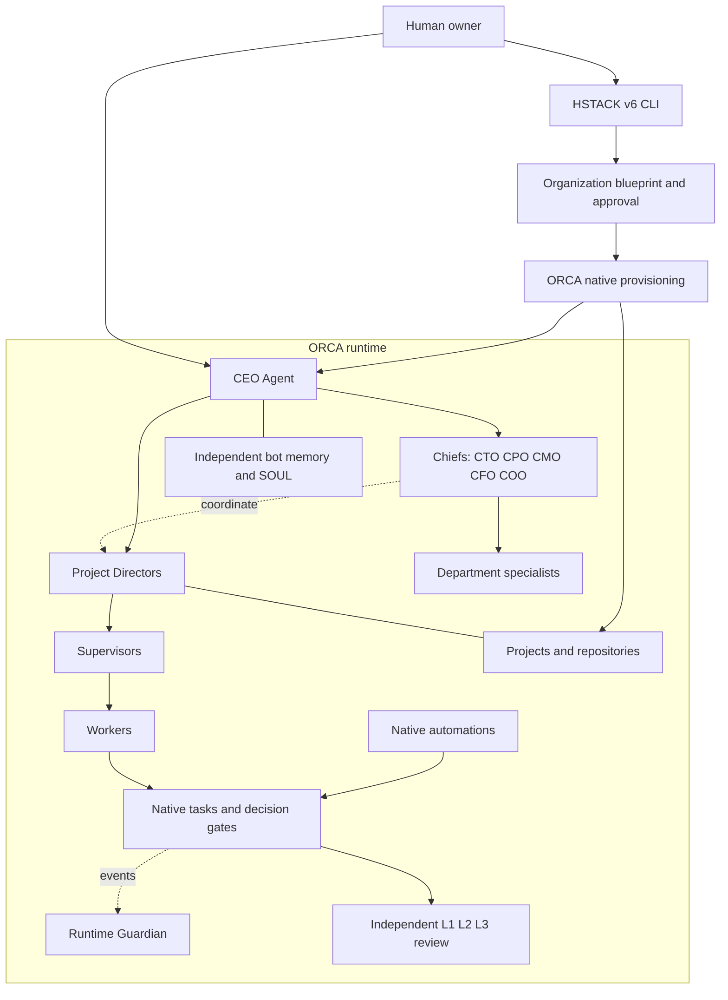

# RFC: HSTACK v6 — Organization Engine

Status: draft proposal, 2026-11-25. No runtime implementation or activation. This proposes a new v6 direction relative to draft #9 (portable actors and adapters); reconcile that RFC explicitly before merging. V5 and its 62 reusable model-agnostic skills remain supported.

## Product vision

HSTACK evolves from a multi-repo skill collection into a CLI engine that turns a natural-language description of a business into an operational organization inside ORCA. ORCA is the runtime and source of truth; HSTACK is the organization designer, bootstrapper and skill library. Agentix is the reference governance architecture (https://github.com/EnzoVezzaro/agentix/pull/11), not a mandatory runtime dependency. No parallel orchestrator, task database, scheduler or daemon. Other runtime adapters are deferred, not promised.

## User experience (proposed commands, not shipped)

- `hstack init`: interactive interview: what organization do you want to create? Gather mission, products/services, existing or new projects, repositories, constraints, available models/tools and owner approval preferences. Ask only necessary questions.
- `hstack plan`: generate an inspectable organization blueprint, role profiles, project graph, repository creation/adoption plan, skills, model routing, permissions, schedules, review gates and cost assumptions. Show a dry-run diff and missing capabilities.
- `hstack apply`: after explicit owner approval, reconcile approved resources through verified native ORCA interfaces. Never create remote repositories, spend money or activate schedules without applicable authorization.
- `hstack status`, `hstack doctor`, `hstack reconcile`: inspect actual native state, capability gaps, drift and recovery; no fabricated status. Destructive changes require separate approval.

Example: "I'm starting a software agency that builds SaaS products and provides consulting." Generate relevant product and client projects, proposed repositories, executive departments, specialist roles and operating workflows, rather than a fixed generic company. Support greenfield and existing ORCA installations.

## Architecture

## Governance and execution

Human retains final authority over CEO, external commitments, merges, deployments, deletions and new spending. CEO and each Chief jointly agree on departmental decisions, initiatives, resources and schedules case by case; no fixed budgets. Agents may communicate directly but assignment follows role grants. CEO directs the organization; each project has a Director, only Directors create Supervisors, only Supervisors create Workers. Default global four-active-worker cap; free worker models, no silent paid fallback. Every task has independent L1 review, L2/L3 as risk requires, human assigns CEO review. Each bot has stable identity, distinct SOUL, memory, skills, model policy and explicit permissions. Specialists are generated for actual business needs; do not proliferate permanent agents without approval. ACC mandatory for project Directors; ProAgents optional. HSTACK skills remain portable and are selected by role and need, not indiscriminately loaded.

Use native persistent tasks, dependency graphs, dispatch attempts, decision gates, evidence and review; reconcile before creating tasks. Native completion is not organizational acceptance. Guardian is event-driven, observe-only initially, with authorized intervention and learning provenance. Default schedules: CEO morning/evening; CTO and CFO every four hours; CPO daily; CMO every six hours; COO hourly; Directors every two hours. Configurable, disabled until approved, with timezone, deduplication and budget checks. Chief and CEO agree on changes.

## Engine implementation

1. Discover installed ORCA version, projects, bots, skills, models, connectors and documented capabilities. Audit native automations, event triggers, prechecks, memory upkeep, worktrees, checkpoints, status hooks, remote hosts, artifacts and browser/computer-use. Record evidence and gaps; experimental orchestration requires local validation.
2. Define a versioned declarative blueprint schema (organization, roles, projects, repos, skills, policies, grants, schedules, review, dependencies). Validate references, uniqueness and constraints. Keep secrets outside blueprints.
3. Build interactive requirements capture and blueprint generation with human-readable preview; treat generated output as untrusted until schema and policy checks pass.
4. Implement native ORCA provisioning adapter using verified APIs only. Adopt existing identities explicitly, preserve memory, idempotently reconcile resources, record native IDs, resume partial failures and provide rollback plan. If native capability missing, block or guide assisted setup, never simulate success.
5. Bootstrap CEO, Chiefs, projects and Directors, then approved specialists and operational policies. Dynamic Supervisors/Workers created only as needed. Provision schedules disabled first; validate and activate separately with owner approval.
6. Integrate existing HSTACK skill contracts and model routing; document V5 migration, backward compatibility and CLI packaging choices. Do not remove existing skills or change current behavior in this RFC.

## Acceptance

- Two materially different businesses produce appropriate, distinct organizations; greenfield and adoption flows work.
- Dry run causes no external changes; repeated apply creates no duplicates; restart resumes partial provisioning; existing identities and memory survive.
- Unsupported APIs, unavailable models, missing grants, invalid blueprints and failed provisioning are surfaced accurately.
- Test governance, unauthorized delegation, fifth concurrent Worker rejection, free-only worker routing, independent review, scheduler overlap and Guardian event coverage.
- Verify actual ORCA state and end-to-end task evidence, including non-code tasks; measure cost and latency against V5 baseline.
- No automatic remote repository creation, external publication, paid commitment, destructive action or production activation without applicable human approval.

## Open decisions

CLI language/package distribution, exact native API availability, organization isolation across multiple companies, blueprint persistence format, and whether portable runtime adapters from #9 return later. Resolve with evidence and owner approval. This RFC is a proposal, not a release or proof of working runtime.
