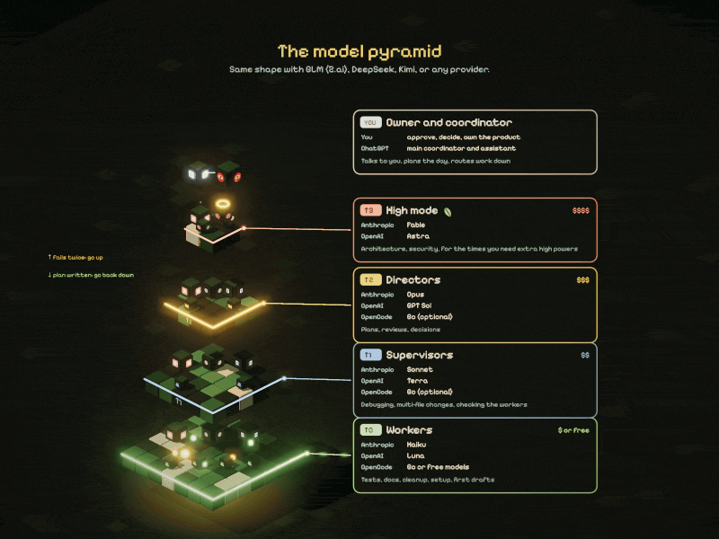
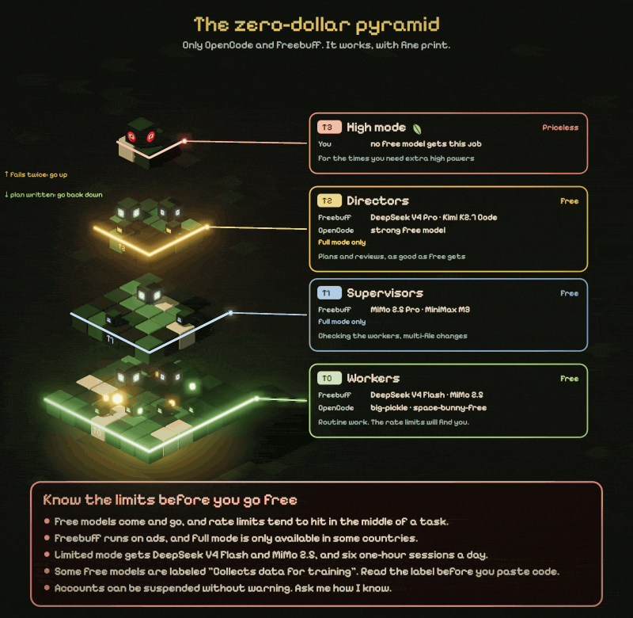

<!-- Generated from docs/model-routing.md by scripts/quality/generate_skill_references.py; do not edit. -->

# Model routing: escalate and downgrade

HStack runs on one rule from V5: **expensive intelligence makes decisions, cheap intelligence does the work.** This page turns that rule into something every skill follows: which tier starts a task, when it moves up, and when it moves back down.

Your own map lives in your `AGENTS.md` (or `CLAUDE.md`) under a `## hstack models` heading. Run [`/setup-hstack`](https://github.com/EnzoVezzaro/hstack/blob/main/skills/setup-hstack/SKILL.md) to detect your agents and write it. Without that block, skills use the defaults below.

H Stack coordinates a **multi-repo** setup. Name the target `<project>` for every task, resolve it to the exact Orca repo/worktree, and keep each repo's instructions, model map, quota observations, and worktree state separate. For tasks spanning repos, list each project explicitly. Use [`/token-balancer`](https://github.com/EnzoVezzaro/hstack/blob/main/skills/token-balancer/SKILL.md) for read-only, evidence-based quota and model recommendations across a named project set.

## Tiers

| Tier | Name | Anthropic | OpenAI | Others | Use it for |
| --- | --- | --- | --- | --- | --- |
| You | Owner | | | | Approve, decide, own the product. Nothing ships without you |
| ChatGPT | Main coordinator and assistant | | | | Talks to you, plans the day, routes work down |
| **T3** | High mode | Fable | Astra | | Architecture, security, extra high powers, and briefs that failed lower down |
| **T2** | Directors | Opus | GPT Sol | OpenCode Go (optional) | Planning, acceptance criteria, reviews, decisions |
| **T1** | Supervisors | Sonnet | Terra | Capable free OpenCode models (preferred for routine supervision); OpenCode Go (optional, paid) | Debugging, multi-file changes, checking the workers |
| **T0** | Workers | Haiku | Luna | OpenCode Go or free models | Routine execution: tests, docs, cleanup, setup, data gathering, first drafts |

OpenCode Go can be assigned at any tier: director, supervisor or worker. Pick the cheapest capable tier; a paid model is not required just because it is Go. For routine supervision, prefer a capable free OpenCode model and check availability live; Freebuff free models are an option when that account is active, but it is currently suspended for this user. Use paid supervision only when the task needs it. These are the defaults. `/setup-hstack` detects which of them you actually have and writes your own map.

### Any provider fits the same shape

The tiers describe jobs, not brands. GLM (Z.ai), DeepSeek, Kimi, or any other provider works the same way: the provider's strongest model goes in high mode, its flagship in directors, a mid-size model in supervisors, and its fast or flash model in workers. Mixing providers is fine, as long as the model that checks a change is not the one that wrote it.

### The zero-dollar version

| Tier | Name | Models | Notes |
| --- | --- | --- | --- |
| **T3** | High mode | You | For the times you need extra high powers, the call stays with you |
| **T2** | Directors | Freebuff: DeepSeek V4 Pro, Kimi K2.7 Code; OpenCode: strong free model | Freebuff full mode only |
| **T1** | Supervisors | Capable free OpenCode models (prefer); Freebuff: MiMo 2.5 Pro, MiniMax M3 | Freebuff full mode only; that account is currently suspended for this user |
| **T0** | Workers | Freebuff: DeepSeek V4 Flash, MiMo 2.5; OpenCode free models (`big-pickle`, `space-bunny-free`) | Also in Freebuff's limited mode |

For routine supervision prefer a capable free OpenCode model; Freebuff free models are an option only when that account is active. Check availability live and use paid supervision only when the task needs it.

Know the limits before you go free:

- Free models come and go, and rate limits tend to hit in the middle of a task.
- Freebuff runs on ads, and full mode is only available in some countries.
- Limited mode gets DeepSeek V4 Flash and MiMo 2.5, and six one-hour sessions a day.
- Some free models are labeled "Collects data for training". Read the label before you paste code.
- Accounts can be suspended without warning. Mine is, right now; see the note in the README.

Freebuff's model names follow its README, and versions move fast (this machine already had `mimo-v2.6-pro` configured).

## Start low

Start every task at the lowest tier that can do it. Most HStack skills start with the workers (T0) or supervisors (T1); each skill states its starting tier in its **HStack V5 role** section.

## Escalate one tier when

1. The same brief fails verification twice at the current tier.
2. The task touches architecture, security, money, deleting data, or a product decision.
3. The worker reports low confidence, or two workers return conflicting results.
4. The context the task needs is larger than the current model handles well.

Escalate one tier at a time. Say in the report why you escalated.

## Downgrade when

1. A higher tier has written the plan or the acceptance check. Execution goes back to T0 or T1 with that brief.
2. The task turned out to be routine.
3. The free model you wanted is down or rate-limited. Try the next free model before a paid one.

## Always

- The agent that verifies is not the agent that wrote the change. Prefer a different model.
- Paid tiers (T2, T3) are spent on decisions and reviews, not on typing.
- Respect any budget written in your `AGENTS.md`. If a task would exceed it, stop and ask.
- Escalating never skips the owner's approval for outward-facing actions.
